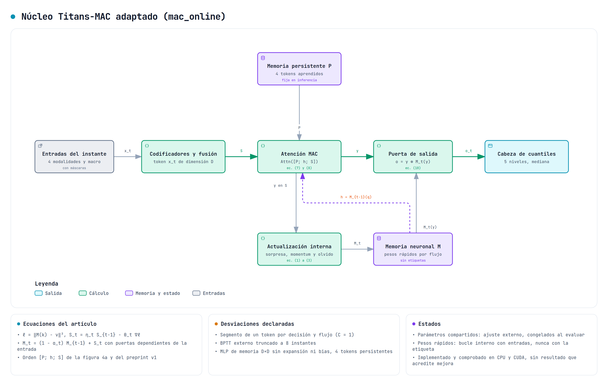
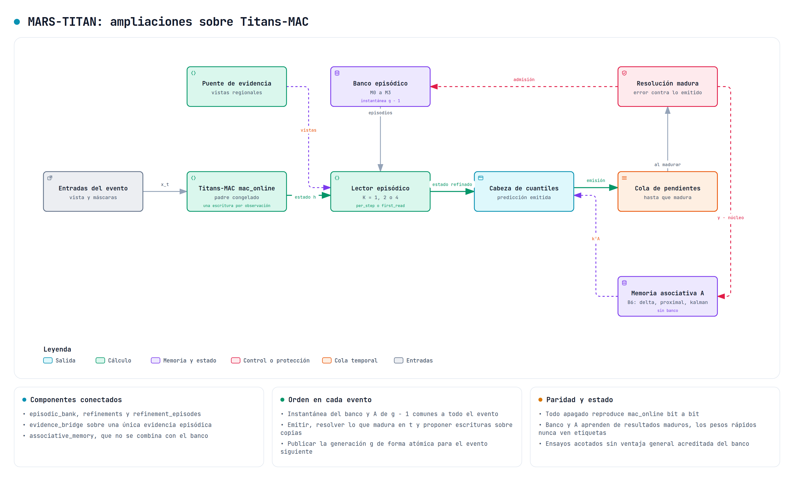
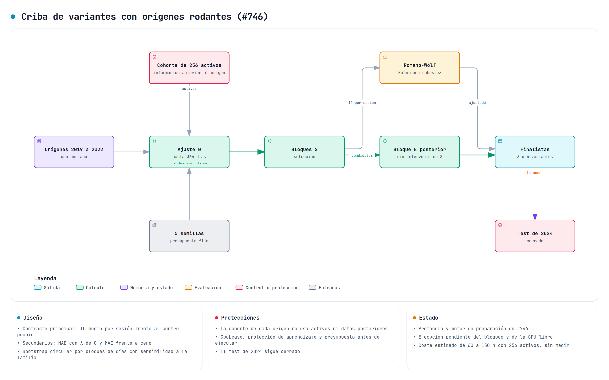

# Diagramas de los modelos y de las variantes

Esta carpeta reúne los diagramas de arquitectura de MARS-TITAN hechos con [archify](https://github.com/tt-a1i/archify) 2.17 (licencia MIT). Cada figura tiene una especificación JSON, que es la fuente, y una imagen PNG con fondo blanco a 3200 píxeles de ancho. Las especificaciones pasan la validación `showcase` de archify, que comprueba solapes, etiquetas, legibilidad y recorrido de las flechas.

Los diagramas describen el diseño y el estado de implementación del 23 de octubre de 2026. No muestran resultados. Una variante dibujada no está entrenada ni evaluada salvo que su tarjeta de estado lo diga, y ninguna figura atribuye mejoras predictivas.

## Modelos

| Figura | Qué muestra | Documento |
| --- | --- | --- |
| [Recorrido completo](models/pipeline.png) | Datos con disponibilidad, modelos comparados y evaluación por sesión | [Arquitectura](../engineering/architecture.md) |
| [Referencia GRU con banco episódico](models/gru-episodic.png) | Candidato GRU conservado como referencia independiente | [Sesiones GRU](../engineering/gru-financial-sessions.md) y [banco episódico](../engineering/episodic-session-bank.md) |
| [Referencia Transformer compacta](models/transformer-compact.png) | Codificador Transformer con la misma canalización | [Transformer compacto](../engineering/compact-transformer-reference.md) |
| [Núcleo Titans-MAC](models/titans-mac.png) | `mac_online` con las ecuaciones del artículo y sus desviaciones declaradas | [Dirección arquitectónica](../research/titans-mac-architecture.md) |
| [MARS-TITAN](models/mars-titan.png) | Ampliaciones desactivables sobre Titans-MAC | [MARS-TITAN con ampliaciones](../engineering/mars-titan-extensions.md) |
| [Factorial CM-v1](models/cm-v1.png) | B, B+C, B+M y B+C+M sobre el mismo núcleo | [Factorial CM-v1](../experiments/mars_titan_cm_v1/factorial.md) |
| [Orden de un evento](models/session-event-order.png) | Validación, instantánea, emisión, maduración y publicación atómica | [FinancialSession v2](../engineering/financial-session-v2.md) |





## Variantes del estudio de octubre

Las variantes proceden del estudio registrado en [#742](https://github.com/GonxKZ/mars-titan/issues/742). Cada figura indica su mecanismo, la fuente que lo motiva, el control que permitiría descartarla y su estado. Todas pasan por la misma [criba con orígenes rodantes](variants/screening-protocol.png) de [#746](https://github.com/GonxKZ/mars-titan/issues/746) y se comparan con la [fase 0b](variants/phase0b-anomaly-ceiling.png) de [#747](https://github.com/GonxKZ/mars-titan/issues/747), que mide cuánta señal extraen rasgos conocidos con modelos sencillos.

| Grupo | Figuras | Issue |
| --- | --- | --- |
| A · Salida y abstención | [A1 contracción de escala](variants/a1-scale-shrink.png), [A2 abstención neutral](variants/a2-neutral-abstention.png), [A3 conformal ponderado](variants/a3-regime-weighted-conformal.png), [A4 cabezas oponentes](variants/a4-opponent-heads.png) | [#744](https://github.com/GonxKZ/mars-titan/issues/744), [#748](https://github.com/GonxKZ/mars-titan/issues/748) y [#749](https://github.com/GonxKZ/mars-titan/issues/749) |
| B · Memoria por áreas | [B1 memoria redundante](variants/b1-redundant-area-memory.png), [B2 consulta entre áreas](variants/b2-area-query-bridge.png), [B3 claves ligadas a roles](variants/b3-role-bound-keys.png), [B4 lesiones](variants/b4-lesion-protocol.png) | [#750](https://github.com/GonxKZ/mars-titan/issues/750) |
| C · Regiones y jerarquía | [C1 mezcla entre cabezas](variants/c1-region-axis-mixing.png), [C2 atención axial](variants/c2-axial-time-region.png), [C3 operador compartido](variants/c3-fractal-shared-operator.png), [C4 regiones en fecha](variants/c4-pit-region-gate.png), [C5 atención entre activos](variants/c5-cross-asset-attention.png), [C6 espacio de trabajo](variants/c6-shared-workspace.png) | [#751](https://github.com/GonxKZ/mars-titan/issues/751) |
| D · Profundidad y parada | [D1 bucles anidados](variants/d1-nested-equal-depth.png), [D2 parada adaptativa](variants/d2-adaptive-bridge-stop.png) | [#751](https://github.com/GonxKZ/mars-titan/issues/751), [#709](https://github.com/GonxKZ/mars-titan/issues/709) y [#734](https://github.com/GonxKZ/mars-titan/issues/734) |
| E · Escalas y consolidación | [E1 mezcla de escalas](variants/e1-multiscale-mature-mixture.png), [E2 consolidación espaciada](variants/e2-spaced-utility-consolidation.png), [E3 escritura por saliencia](variants/e3-salience-write-budget.png), [E4 puerta de régimen](variants/e4-regime-evidence-gate.png) | [#750](https://github.com/GonxKZ/mars-titan/issues/750) |
| F · Objetivo y ajuste | [F1 escala de Laplace](variants/f1-laplace-scale-head.png), [F2 semillas y EMA](variants/f2-seed-ema-ensemble.png), [F3 optimizador y continuación](variants/f3-optimizer-continuation.png), [F4 rangos e IC](variants/f4-session-rank-ic.png), [F5 horizontes auxiliares](variants/f5-auxiliary-horizons.png) | [#749](https://github.com/GonxKZ/mars-titan/issues/749) |
| G · Autoedición, políticas y auditoría | [G1 autoedición acotada](variants/g1-posthoc-self-edit.png), [G2 políticas financieras](variants/g2-policy-rules.png), [G3 auditoría as-of](variants/g3-asof-ledger-audit.png) | [#748](https://github.com/GonxKZ/mars-titan/issues/748), [#711](https://github.com/GonxKZ/mars-titan/issues/711), [#365](https://github.com/GonxKZ/mars-titan/issues/365) y [#442](https://github.com/GonxKZ/mars-titan/issues/442) |



## Regenerar las imágenes

Las imágenes se generan desde las especificaciones con Node.js y Chrome o Chromium. `ARCHIFY_HOME` indica la carpeta local de archify, y `ARCHIFY_CHROME` la ruta del navegador si no se encuentra sola.

```bash
ARCHIFY_HOME=<carpeta de archify> scripts/render_diagrams.sh
ARCHIFY_HOME=<carpeta de archify> scripts/render_diagrams.sh mars-titan c3-fractal-shared-operator
```

El script valida cada especificación con el perfil `showcase`, genera el HTML interactivo en `build/diagrams/`, que no se versiona, y exporta el PNG con [`scripts/export_diagrams.mjs`](../../scripts/export_diagrams.mjs). La exportación usa el estilo de impresión del visor, que fija la paleta clara y quita la rejilla, y oculta los controles. Los textos de los diagramas están en español. El visor HTML conserva sus menús en inglés porque archify todavía no admite otro idioma, y en la imagen solo se traduce el título de la leyenda.
