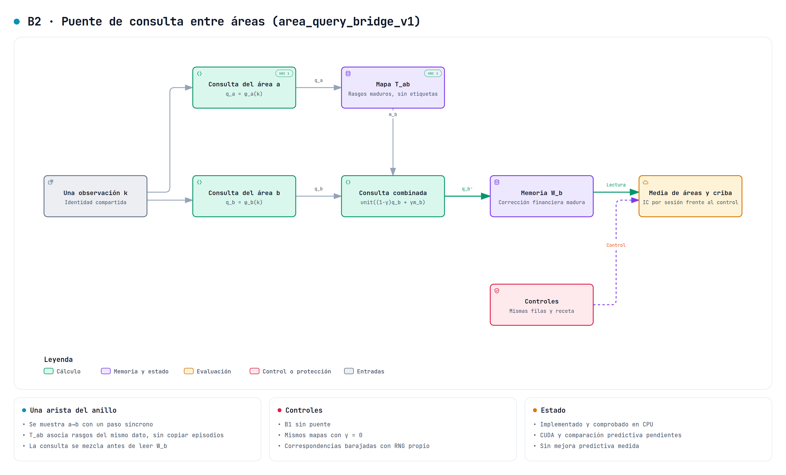

# Puente de consultas entre áreas (B2)

`area_query_bridge_v1` añade traducciones de consulta a la [memoria por áreas B1](redundant-area-memory-v1.md). Cada área conserva sus pesos de corrección y cada arista conserva un mapa entre los rasgos de una misma observación en dos áreas. No se crean registros adicionales del episodio ni se trasladan sus etiquetas entre almacenes. El componente es opcional y tiene identidad propia. No hay una mejora predictiva medida.

El [puente episódico regional](shared-evidence-bridge-v1.md) comparte candidatos de un snapshot y comunica lecturas derivadas. B2 actúa antes de leer las matrices de corrección de B1. Se mantiene como mecanismo separado porque esos dos puntos de intervención no son intercambiables.

## Qué se escribe y cuándo

Sean φₐ(k) y φᵦ(k) los rasgos DPFP normalizados de la misma clave del codec en las áreas a y b. El grafo es un anillo dirigido, b = (a + 1) mod A. Cada arista guarda Tₐᵦ ∈ ℝᴰˣᴰ, con D = 2dν. Las matrices Wₛ de B1 siguen guardando el objetivo financiero `etiqueta − núcleo`. Los mapas T no usan ese valor financiero.

Se reutiliza `AssociativeMemory`, con la misma regla, η y λ que las áreas. Para la escritura proximal de una cohorte madura:

$$
(I+\eta\Phi_a^\mathsf{T}\Omega\Phi_a)T_{ab}^{+}
=\rho T_{ab}+\eta\Phi_a^\mathsf{T}\Omega\Phi_b,
\qquad \rho=1-\lambda,\quad \Omega=I/n.
$$

La implementación resuelve el sistema mediante Cholesky, sin invertirlo. La regla delta también se admite y actualiza fila a fila, en orden canónico, con el residuo `φᵦ − Tₐᵦᵀφₐ`. La retención se aplica por fila en delta y por cohorte en proximal, como en B1. No se interpretan como la misma dinámica.

Los mapas solo reciben las observaciones cuyas etiquetas financieras ya son elegibles para B1. Es una restricción de disponibilidad del proyecto. No pretende reproducir el ritmo de maduración de un recuerdo biológico. Permite conservar exactamente el calendario de escrituras y el conjunto de observaciones de la comparación. El resultado financiero no interviene en la asociación entre rasgos.

## Lectura y pasos de consulta

La consulta empieza en qₛ⁰ = φₛ(k). Todos los pasos usan las matrices T confirmadas antes del evento. Para cada arista a→b:

$$
m_b^j=T_{ab}^{\mathsf{T}}q_a^j,\qquad
q_b^{j+1}=\operatorname{unit}\big((1-\gamma)q_b^j+\gamma m_b^j\big),\qquad
\widehat c=\frac{1}{|S|}\sum_{s\in S}(q_s^J)^\mathsf{T}W_s.
$$

`unit` devuelve norma uno, o cero para el vector nulo. Reescala por el máximo absoluto antes de calcular la norma, y rechaza NaN o Inf antes de mezclar y normalizar. Las actualizaciones son síncronas: ningún área lee una consulta que otra acaba de modificar dentro del mismo paso.

La comparación principal declara J = 1 y γ = 0,25. El código admite de uno a cuatro pasos. J no cuenta lecturas episódicas K ni avances de la memoria de Titans. Con γ = 0 se devuelve la consulta original sin hacer productos con los mapas. El control sigue escribiendo y guardando T para separar ese coste del uso de la traducción.

Una máscara física de áreas corta tanto la lectura como las aristas entrantes y salientes del área ausente. Las salidas activas se promedian de nuevo por su número. Si γ = 1 y un área activa no recibe un mensaje válido, su consulta queda a cero. No se sustituye por otra consulta en silencio. Esta posibilidad puede empeorar la recuperación y necesita su propio estudio de lesiones.

## Información compartida y límites matemáticos

Los mapas son asociaciones en pesos entre dos representaciones del mismo identificador. No son copias del dato fuente. Una traducción exacta de las permutaciones antes de DPFP devolvería la consulta directa de B1 y no añadiría un mecanismo predictivo. B2 usa regresiones entre las proyecciones posteriores a DPFP.

Esas proyecciones pueden perder información. Por ejemplo, para k = (1/√2, 0, 1/√2, 0), DPFP₁ con el orden original es cero. Si se permuta a (k₀, k₂, k₁, k₃), hay un producto adyacente no nulo. Ningún mapa lineal aplicado a la primera proyección cero puede reconstruir la segunda para todos los casos. Por eso T aproxima una relación sobre el pasado observado y no es una inversa universal.

Normalizar la consulta acota su norma, pero no prueba estabilidad global, retención semántica ni buena predicción. La derivada de la normalización puede ser grande cerca de cero. La cota de contracción de una escritura de `AssociativeMemory` con entradas fijas no se extiende automáticamente a la composición de traducciones y normalizaciones. No se aplica aquí una garantía de Crouzeix ni se activa el factor C de CM-v1.

## Controles e integración

Los cuatro modelos están declarados en [area-query-bridge-v1.json](../../configs/experiments/area-query-bridge-v1.json). Comparten padre, filas, ventanas, semillas y receta de B1:

- `bridge` usa las correspondencias de la misma observación.
- `no_bridge` es B1 sin mapas T adicionales.
- `same_maps_zero_gain` guarda los mismos mapas con γ = 0. Iguala su capacidad y escritura, pero omite el cálculo de traducción al leer.
- `shuffled_correspondence` baraja los destinos φᵦ dentro de cada cohorte, conservando sus vectores y rompiendo el emparejamiento con φₐ. Usa PCG64 con dominio fijo `0xB2`, semilla, primer ID canónico y área emisora, sin tocar los RNG globales. El dominio separa su flujo del barajado de etiquetas de B1. Se corrigió después de comprobar que `[semilla, id]` y `[semilla, id, 0]` generaban el mismo flujo. Una cohorte de una sola observación no puede romperse con ese barajado.

`MatureCorrection.query_bridge` exige B1 con al menos dos áreas y regla delta o proximal. La configuración se valida en `mars_titan_variant` y en la ventana común de B6. El padre mantiene sus parámetros congelados durante la inferencia y sus pesos rápidos de Titans avanzan por su política anterior. Todas las predicciones de un evento leen el mismo estado, y las matrices W y T se publican después de procesar sus resultados maduros.

Sin `query_bridge`, la identidad y el esquema de exportación de B1 se conservan. Con B2, el esquema de área pasa a versión 2 e incluye los mapas, su configuración, contadores, cursor y huellas. La matriz de diagnóstico reúne en una columna todos los coeficientes de W y T. La sesión incluye el código de los módulos de memoria activos en su identidad. Un checkpoint de otra configuración o revisión se rechaza.

Las matrices internas y exportadas usan almacenamiento contiguo. Se comprobó este contrato tras detectar que el resultado por columnas de Cholesky no era admisible en `SessionArtifacts`. Conservar el mismo formato antes y después de recuperar evita cambiar el recorrido numérico de la siguiente consulta. No se han relajado los requisitos del almacén ni las tolerancias de recuperación.

El estado escrito queda separado de autograd. Las consultas conservan sus gradientes a través de la traducción y la normalización cuando se usan en una comprobación diferenciable. No se retiene el grafo de las cohortes pasadas. La combinación con el banco episódico sigue pendiente y se rechaza, como en B1.

## Fuentes y alcance de la analogía

Kitamura et al. (2017), [*Engrams and circuits crucial for systems consolidation of a memory*](https://pmc.ncbi.nlm.nih.gov/articles/PMC5493329/), DOI 10.1126/science.aam6808, estudian la relación entre circuitos hipocampales y prefrontales durante la consolidación de memoria de miedo contextual en ratones. Se revisaron el texto y las figuras 2 a 4 del manuscrito disponible en PMC. La conexión funcional motiva estudiar interacción entre memorias, sin proporcionar las ecuaciones de B2.

Roy et al. (2022), [*Brain-wide mapping reveals that engrams for a single memory are distributed across multiple brain regions*](https://www.nature.com/articles/s41467-022-29384-4), DOI 10.1038/s41467-022-29384-4, examinan conjuntos neuronales distribuidos y su reactivación en ratones. Se revisaron los resultados sobre conexión funcional y reactivación conjunta. La observación no demuestra que repartir correcciones financieras ni traducir consultas mejore una predicción.

Las reglas asociativas y DPFP conservan los antecedentes y las desviaciones de [B1](redundant-area-memory-v1.md#fuentes). La composición de mapas, mezcla y contrato temporal es una propuesta de este proyecto. No se afirma novedad frente a toda la literatura ni una reproducción del cerebro.

## Coste y comprobaciones

Los mapas añaden A·D² coeficientes FP64. Con cuatro áreas y D = 128 son 524.288 bytes adicionales, además de las matrices e índices de B1. Una lectura cuesta O(JABD²) para las traducciones, y cada escritura proximal añade productos de cohorte y un sistema de D columnas de salida por arista. No se iguala el coste de B1 por tener las mismas filas.

El [benchmark técnico](../../benchmarks/area_memory_cost.py) mide lectura, escritura, percentiles, bytes de estado y pico de RAM del proceso. También distingue uno, dos y cuatro pasos. La implementación se comprueba con referencias de ecuaciones, gradientes, causalidad, máscaras físicas, RNG y recuperación nativa. Estas comprobaciones usan fixtures y no acreditan mejora sobre FinMultiTime. La interoperabilidad CUDA y la comparación predictiva permanecen pendientes mientras continúen sus restricciones de ejecución.

La [escritura proximal compartida](../engineering/paired-proximal-write.md) evita repetir el Gram y Cholesky de W y T. Conserva los estados y la regla de B2. Las medidas siguientes corresponden a la versión anterior a esa optimización y se conservan como evidencia histórica.

La [verificación del 26 de octubre](../../reports/engineering/area-query-bridge-20261026/verification.json) aprobó 226 casos CPU en la versión final. Las 17 guardas del bloqueo habían pasado en la batería anterior al cambio del dominio RNG, con su código intacto. Tres casos CUDA quedaron deseleccionados por la ocupación de la GPU. Las [nueve mutaciones dirigidas](../../reports/engineering/area-query-bridge-20261026/mutations.json) se detectaron entre dos referencias verdes. Incluyen dirección del anillo, sincronía, correspondencias barajadas, áreas inactivas, formato al recuperar, versión del esquema, etiquetas futuras, ocultación de desbordamientos y reutilización del flujo de etiquetas.

Coverage.py 7.16.1 midió 108 de 113 sentencias y 35 de 40 ramas en el módulo nuevo. El [informe de calidad](../../reports/engineering/area-query-bridge-20261026/quality.json) usa Radon 6.0.1 y CRAP = C² × (1 − cobertura de sentencias)³ + C, con máximo 16,75 en la validación del estado. Se publica aparte la [cobertura de integración](../../reports/engineering/area-query-bridge-20261026/quality-integration.json). Son diagnósticos de los recorridos comprobados, sin garantía de ausencia de errores.

Se conservan las medidas anteriores y una pasada posterior a la corrección del dominio RNG, en Ryzen 9 8945HS, FP64 y dos hilos. Usan cohortes de 64, 256 y 1.024, tres calentamientos y veinte repeticiones. La siguiente tabla corresponde a la [versión final](../../reports/engineering/area-query-bridge-20261026/cost.json), con 256 filas:

| Variante | Lectura p50 | Escritura p50 | Bytes numéricos residentes |
| --- | ---: | ---: | ---: |
| B1 sin puente | 4,322 ms | 7,589 ms | 6.144 |
| B2, un paso | 4,878 ms | 10,834 ms | 530.432 |
| Mismos mapas, γ = 0 | 2,657 ms | 12,219 ms | 530.432 |
| Correspondencias barajadas | 4,758 ms | 12,845 ms | 530.432 |
| B2, dos pasos | 7,005 ms | 12,476 ms | 530.432 |
| B2, cuatro pasos | 11,652 ms | 14,818 ms | 530.432 |

Los modelos se midieron por bloques, con cargas ajenas activas. El cálculo de escritura no cambia con J, y esas diferencias no demuestran un efecto de sus pasos. Tampoco se atribuye una aceleración de B1 al control con γ = 0. La [primera pasada](../../reports/engineering/area-query-bridge-20261026/cost-first.json), la [repetición anterior al arreglo RNG](../../reports/engineering/area-query-bridge-20261026/cost-before-rng-fix.json) y las muestras individuales permiten revisar la variación. Se conservan sus propias huellas de código y no se mezclan como réplicas de la versión final. No se adoptó ninguna optimización basándose en estas diferencias.

El tramo interno de la última pasada duró 38,13 s. El [reloj externo](../../reports/engineering/area-query-bridge-20261026/cost-process.json) midió 39,76 s, incluido el arranque de Python y PyTorch, y un pico de 711 MB de RAM. Los bytes de la tabla excluyen objetos Python y temporales. No se han medido energía, pico de VRAM ni el recorrido completo del predictor CUDA.

Las nuevas pruebas de emisiones de B1 y Nadaraya-Watson comparan FP64 directamente. Las anteriores construían tensores FP32 antes de comparar. Se conservan los recibos históricos y se publica esta corrección de evidencia con la nueva ejecución.

Se ejecutó además la misma [comprobación de regresión](../../reports/engineering/area-query-bridge-20261026/baseline_parity.py) sobre el código de `cdd8b4f5f` y sobre la versión actual, en procesos separados. Los seis casos de B6 y B1 con delta, proximal y etiquetas barajadas conservan lecturas, estados e identidades bit a bit. Los recibos [de referencia](../../reports/engineering/area-query-bridge-20261026/baseline-reference.json) y [actual](../../reports/engineering/area-query-bridge-20261026/baseline-current.json) identifican los módulos importados por sus huellas. Es una regresión numérica sobre fixtures, sin una comparación predictiva.
