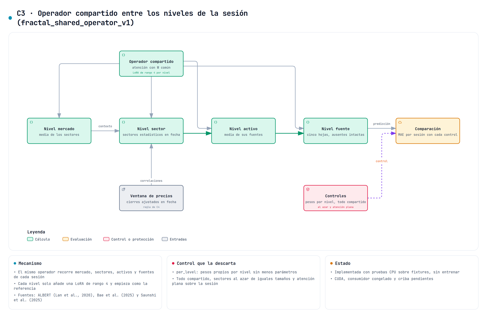

# Operador compartido entre los niveles de la sesión

`fractal_shared_operator_v1` es la variante C3 del estudio de variantes ([#742](https://github.com/GonxKZ/mars-titan/issues/742), [#751](https://github.com/GonxKZ/mars-titan/issues/751)). Antes de la fusión, recorre de arriba abajo una jerarquía de cuatro niveles dentro de cada sesión de un mercado (el mercado, sus sectores estadísticos, sus activos y las cinco fuentes de cada activo) con el mismo operador de atención en cada nivel y una adaptación de rango bajo propia de cada uno. Está implementada en `src/mars_titan/models/titans/fractal_shared_operator.py` y declarada en [su configuración](../../configs/experiments/fractal-shared-operator-v1.json) junto a cuatro controles. Solo se ha comprobado con pruebas técnicas sobre fixtures. No se ha entrenado y no hay ninguna mejora medida.



## Motivación y alcance

En `mac_online` cada activo se fusiona por separado y la información de los demás solo llega a través de la atención entre activos C5, después de MAC, o de la memoria de mercado PT4. C3 pregunta si conviene que cada fuente de un activo lea, antes de fusionarse, el contexto de su activo, de su sector y de su mercado en la misma sesión, y si para eso basta un único operador repetido en cada nivel. «Fractal» describe esa repetición del mismo cálculo a varias escalas. No es una afirmación sobre la geometría de los mercados.

El reparto de un operador entre capas viene de ALBERT ([Lan et al., 2020](https://arxiv.org/abs/1909.11942v6)), que comparte por defecto todos los parámetros entre capas (sección 3.1, página 4). Su tabla 4 (sección 4.5, página 7) muestra con ALBERT-base que compartirlo todo resta 1,5 puntos de media con E = 128 y 2,5 con E = 768, sobre todo por compartir la red feed-forward, mientras que compartir solo la atención deja la media en +0,1 y −0,7. C3 solo comparte un operador de atención. [Bae et al. (2025)](https://arxiv.org/abs/2410.20672v3) relajan el reparto con una LoRA por profundidad, que es lo que C3 añade en cada nivel, y [Saunshi et al. (2025)](https://arxiv.org/abs/2502.17416v1) observan que un bloque repetido casi iguala a un modelo profundo sin repetir en problemas sintéticos de razonamiento. Las tres fuentes son de lenguaje o de razonamiento sintético y no validan nada sobre residuos financieros.

## Jerarquía de una sesión

Una sesión son todas las filas del bloque con el mismo mercado y el mismo instante de decisión, así que C3 exige el bloque completo de la sesión (`session_complete`), igual que C5. Con $z_{i,m}$ el bloque de la fuente m del activo i, $P_i$ sus fuentes presentes y $g(i)$ su sector,

$$
a_i=\frac{1}{|P_i|}\sum_{m\in P_i}z_{i,m},\qquad
s_g=\frac{1}{|g|}\sum_{g(i)=g}a_i,\qquad
c=\frac{1}{G}\sum_{g}s_g .
$$

El nodo de mercado es la media de los sectores y no la de los activos, para que un sector grande no domine el contexto del mercado.

**Sectores estadísticos en fecha.** No hay una clasificación sectorial en fecha en la edición, y el reparto actual de las fichas tiene fuga, así que C3 agrupa los activos de cada sesión por la correlación de sus rendimientos diarios en la ventana de precios. El rendimiento de cada paso es la diferencia del canal `log_close_to_anchor_close` entre dos sesiones consecutivas de la ventana, y solo cuenta si el canal de presencia marca las dos para ese activo. Una ventana sin canal de presencia cuenta todas sus sesiones como observadas. La regla de agrupamiento es la de la puerta por regiones C4, en el módulo común `src/mars_titan/data/correlation_regions.py`: cada serie se estandariza con sus propios rendimientos, la correlación de cada par usa sus rendimientos comunes y vale cero si comparten menos de 32, y el enlace medio sobre 1 − ρ se corta en k = 8 grupos numerados por su menor activo. Los activos con menos de 32 rendimientos válidos o con la serie constante forman el sector 0, que entra en la jerarquía como un sector más.

Los cierres de la ventana son los ajustados por splits y dividendos del archivo original, así que los rendimientos no saltan con un split y recogen los dividendos. La ventana termina en la sesión de la decisión, de modo que el reparto no lee nada posterior a la emisión. Con las entradas en rangos de F4, los sectores se calculan con la ventana recibida, antes de los rangos. [Kakushadze y Yu (2016)](https://arxiv.org/abs/1607.04883v4) construyen clasificaciones estadísticas de varios niveles. En su resumen se preguntan si conviene agrupar las correlaciones o los rendimientos, responden que ninguna de las dos cosas y añaden que sus backtests cambian bastante con esos detalles. C3 agrupa correlaciones, así que la objeción le afecta de lleno. No ajusta la regla de C4 y deja que el control `random_partition` mida si el reparto aporta algo.

El agrupamiento se hace en CPU con SciPy, así que cada bloque copia una vez su ventana de precios a la CPU y espera a la GPU en ese punto.

## Ecuaciones ejecutadas

$O_\ell(x;C)$ es una atención con normalización previa y cuatro cabezas de dimensión $d_h=H/4$, con la consulta desde x y las claves y los valores desde el conjunto C:

$$
O_\ell(x;C)=W^o_\ell\Bigl[\textstyle\sum_{y\in C}\operatorname{softmax}_{y}\bigl(q\cdot k_y/\sqrt{d_h}\bigr)\,v_y\Bigr]_h,\qquad
q=W^q_\ell\operatorname{LN}(x),\ k_y=W^k_\ell\operatorname{LN}(y),\ v_y=W^v_\ell\operatorname{LN}(y),
$$

con $W^\ast_\ell=W^\ast+B^\ast_\ell A^\ast_\ell$. W y la normalización son comunes a los tres niveles y cada nivel ℓ añade una LoRA de rango r = 4 en las cuatro proyecciones. El mismo operador recorre la jerarquía de arriba abajo:

$$
s'_g=s_g+O_{\text{mercado}}\bigl(s_g;\{c\}\cup\{s_h\}\bigr),\qquad
a'_i=a_i+O_{\text{sector}}\bigl(a_i;\{s'_{g(i)}\}\cup\{a_j:g(j)=g(i)\}\bigr),
$$

$$
z'_{i,m}=z_{i,m}+O_{\text{activo}}\bigl(z_{i,m};\{a'_i\}\cup\{z_{i,k}:k\in P_i\}\bigr)\quad\text{para }m\in P_i .
$$

Una fuente ausente conserva su bloque y no entra como clave. Su consulta siempre tiene al menos el nodo de su activo, así que ningún softmax queda vacío, y su salida se descarta. $W^o$ y $B_\ell$ empiezan en cero, así que al construirse la salida es z y el predictor emite exactamente lo mismo que su referencia. A se inicializa como `nn.Linear` y B a cero, igual que la implementación de referencia [`loralib`](https://github.com/microsoft/LoRA/blob/c4593f060e6a368d7bb5af5273b8e42810cdef90/loralib/layers.py#L119-L125), con escala α/r = 1. La semilla de C3 se deriva de la del predictor con SHA-256, no depende del tipo y no consume el generador global. C3 no guarda estado entre emisiones y el forward no actualiza parámetros.

## Controles y contrastes

| Modelo | Operador | Parámetros con H = 64 | Pregunta |
| --- | --- | ---: | --- |
| `fractal_shared_operator` | W común y una LoRA de rango 4 por nivel | 22.656 | La variante |
| `per_level` | Un operador propio por nivel, con proyecciones $U_\ell V_\ell$ de rango R = 15 y su normalización | 23.424 | ¿Aporta compartir el operador frente a pesos propios con los mismos parámetros? |
| `all_shared` | El mismo operador en los tres niveles, sin LoRA | 16.512 | ¿Aporta la adaptación de cada nivel? |
| `random_partition` | La variante con los tamaños de sus sectores repartidos al azar | 22.656 | ¿Aportan los sectores estadísticos? |
| `dense_block` | Los mismos parámetros y tres aplicaciones, cada fuente presente atiende a todas las de la sesión | 22.656 | ¿Aporta la jerarquía frente a una atención plana? |

`per_level` es el control registrado en #751. R es el menor rango con el que el control no tiene menos parámetros que la variante: la variante tiene $2H+4H^2+24rH$ y el control $3(2H+8RH)$, así que $R=\lceil(H+6r-1)/6\rceil$. V se inicializa como `nn.Linear` y U con varianza 1/R, de modo que cada entrada de $U_\ell V_\ell$ tiene la varianza $1/(3H)$ de la proyección común de la variante, y la proyección de salida empieza en cero. `random_partition` conserva las etiquetas y los tamaños de los sectores de cada sesión y los reparte entre los activos con historia con un generador que depende de la semilla, el mercado y el instante. El sector 0 no se reparte. Su semilla entra en el estado que se comprueba al cargar pesos, porque en este tipo decide el cálculo y no solo los pesos iniciales.

`all_shared`, `random_partition` y `dense_block` empiezan con los mismos pesos comunes que la variante, y los dos últimos también con las mismas LoRA. Los cuatro contrastes de la declaración comparan la variante con cada control. En la criba, el contraste principal será la variante frente a `per_level`, y los otros tres serán contrastes exigidos, de modo que C3 solo pasa si supera a los cuatro controles con la regla de la criba. Los rangos, las cabezas, k y el mínimo de rendimientos se fijaron al declarar la variante, antes de abrir datos y sin ajustar: k = 8 es el número de regiones de C4 y 32 rendimientos son la mitad de los 63 de la ventana, una proporción parecida a la de las 60 etiquetas de 126 que exige C4.

## Requisitos de ejecución

C3 ocupa la modulación de la fusión y solo se declara sobre `mac_online`. No se combina con el operador regional, C1, C2, C6, PT6 ni la red holográfica H1, que también ocupa esa modulación, ni con la atención entre activos C5, que también mezcla los activos de la sesión. Los tokens fila a fila de `fused_tokens` la rechazan, y por eso tampoco se combina con las cabezas auxiliares de F5. El consumidor congelado, sus cargadores del recorrido y Dust la rechazan hasta que registren su fuente y su reparto. La fuente del módulo y la del agrupamiento común entran en la identidad del entrenador solo cuando C3 está activa.

## Correspondencia con el código y las pruebas

Las pruebas están en `tests/models/titans/test_fractal_shared_operator.py` y las del agrupamiento común en `tests/data/test_correlation_regions.py`. Las ventanas sintéticas tienen tres factores plantados, de modo que los sectores correctos se conocen de antemano.

| Elemento | Código | Prueba |
| --- | --- | --- |
| Ecuaciones de los cinco tipos | `FractalSharedOperator.forward` | `test_the_operator_matches_a_reference_written_node_by_node`, con una referencia nodo a nodo y cabeza a cabeza en FP64 |
| Fuente ausente intacta y sin mensajes | salida enmascarada y claves | `test_an_absent_leaf_keeps_its_block_and_sends_nothing` |
| Cada sesión solo lee sus filas | `sessions` | `test_each_session_only_reads_its_own_rows` |
| Independencia del orden de las filas | sectores sobre activos ordenados | `test_permuting_the_rows_permutes_the_outputs` |
| Sectores con la regla de C4 | `sessions`, `correlation_regions` | `test_the_sectors_are_the_correlation_regions_of_the_daily_returns` |
| Rendimientos entre sesiones presentes | `sessions` | `test_only_returns_between_two_present_sessions_enter_the_sectors` |
| Sector 0 | `correlation_regions` | `test_series_without_min_returns_valid_returns_form_sector_zero` |
| Partición aleatoria de iguales tamaños | `permuted_regions` | `test_the_random_partition_keeps_the_sizes_and_depends_on_the_seed_and_the_session` |
| Paridad al construirse | $W^o=0$, $B=0$, semilla derivada | `test_zero_output_projections_return_the_blocks_exactly`, `test_each_kind_starts_as_the_reference` |
| Inicialización común y recuento de parámetros | construcción | `test_the_kinds_with_a_shared_operator_start_with_the_same_weights` |
| Escala de las LoRA y de los factores del control | construcción | `test_the_lora_and_control_factors_have_the_scale_of_a_linear_layer` |
| Rango R del control | `control_rank` | `test_the_control_rank_is_the_smallest_that_keeps_the_parameters` |
| Gradientes hasta todos los parámetros | autograd | `test_gradients_reach_every_parameter_and_the_present_blocks` |
| Sectores con la ventana anterior a F4 | `FinancialPredictor._fractal_fuse` | `test_the_sectors_use_the_received_window_before_the_session_ranks` |
| Exclusiones de la configuración | `FinancialConfig._check_fractal_shared_operator` | `test_it_is_exclusive_with_other_modulations_session_mixing_and_row_wise_tokens`, `test_it_does_not_combine_with_the_holographic_network` |

## Desviaciones respecto a las fuentes

| Fuente | C3 | Motivo |
| --- | --- | --- |
| ALBERT comparte también la red feed-forward entre capas | Solo se comparte un operador de atención | Es la parte cuyo reparto apenas cambió la media en la tabla 4 de ALBERT, y C3 no añade una red feed-forward |
| Bae et al. convierten un modelo preentrenado y repiten sus capas en profundidad | El operador recorre los niveles de una jerarquía y se ajusta desde cero | No hay un modelo preentrenado para estas entradas y la profundidad son los niveles |
| LoRA inicializa A con una gaussiana (Hu et al., 2022, sección 4.1) | A como `nn.Linear` | Es la inicialización de la implementación de referencia `loralib` |
| #751 habla del mismo operador regional | Un operador de atención propio | `RegionalFusion` está fijado a cinco nodos y aquí los niveles tienen tamaños variables |
| El diagrama de #751 preveía un sector en fecha | Sectores estadísticos de la ventana de precios | La edición no tiene una clasificación sectorial en fecha y la actual tiene fuga |
| El diagrama de #751 preveía el estado del flujo en el nivel del activo | El nodo del activo es la media de sus fuentes presentes | C3 no guarda estado ni lee el de MAC, y así conserva la paridad al construirse |

## Comprobación técnica

Pendiente de la verificación final.

## Coste

La medida CPU del 28 de octubre llama solo a `FractalSharedOperator` con las formas de la emisión, en FP32 y con H = 64, dos hilos, tres calentamientos y veinte repeticiones en cada uno de los dos órdenes de los modelos. Con 64 y 256 filas el bloque es una sesión, y con 1.024 son cuatro sesiones de 256 activos. Las ventanas tienen 64 sesiones con rendimientos que siguen ocho factores comunes, y noticias, fundamentales y macro faltan en parte de las filas. Las proyecciones de salida se fijan distintas de cero para que la atención no se reduzca a la identidad. `sectors` mide solo el reparto, con la copia de la ventana a la CPU y el agrupamiento. `forward` es la inferencia sin gradiente con el reparto incluido y `backward` añade la propagación de una suma de cuadrados hasta los parámetros del módulo, sin optimizador. La regresión de C2 corría a la vez en el mismo equipo, así que los percentiles son descriptivos. El [recibo](../../reports/engineering/fractal-shared-operator-20261028/cost-cpu.json) conserva todas las muestras.

| Reparto | 64 filas | 256 filas | 1.024 filas |
| --- | ---: | ---: | ---: |
| C3 (`shared_lora`) | 3,6 ms (4,0) | 12,4 ms (14,9) | 37,0 ms (47,1) |
| `per_level` | 3,3 ms (3,7) | 13,6 ms (33,7) | 36,9 ms (77,9) |
| `all_shared` | 3,6 ms (3,9) | 12,8 ms (13,9) | 35,6 ms (39,1) |
| `random_partition` | 3,7 ms (4,5) | 12,0 ms (14,2) | 37,4 ms (47,6) |
| `dense_block` | 0,08 ms (0,11) | 0,30 ms (0,34) | 0,94 ms (1,2) |

| Forward | 64 filas | 256 filas | 1.024 filas |
| --- | ---: | ---: | ---: |
| C3 (`shared_lora`) | 10,1 ms (22,4) | 28,3 ms (40,5) | 83,5 ms (139,5) |
| `per_level` | 11,8 ms (16,0) | 31,1 ms (64,3) | 74,8 ms (143,2) |
| `all_shared` | 11,1 ms (20,1) | 31,0 ms (43,3) | 97,6 ms (186,0) |
| `random_partition` | 12,0 ms (14,4) | 27,0 ms (30,9) | 81,7 ms (134,7) |
| `dense_block` | 26,2 ms (29,7) | 483,0 ms (897,0) | 2.059,8 ms (2.782,9) |

| Backward | 64 filas | 256 filas | 1.024 filas |
| --- | ---: | ---: | ---: |
| C3 (`shared_lora`) | 23,8 ms (26,9) | 49,7 ms (60,3) | 187,7 ms (250,2) |
| `per_level` | 21,1 ms (24,0) | 42,6 ms (53,4) | 140,8 ms (257,4) |
| `all_shared` | 20,5 ms (22,9) | 38,4 ms (46,4) | 155,9 ms (254,2) |
| `random_partition` | 20,7 ms (26,0) | 52,3 ms (61,1) | 161,3 ms (295,7) |
| `dense_block` | 47,2 ms (65,2) | 741,5 ms (944,8) | 1.915,4 ms (2.617,2) |

Cada celda da la mediana y, entre paréntesis, el percentil 95 de las cuarenta muestras. Las diferencias entre la variante y sus tres controles jerárquicos no superan la dispersión de la medida. El reparto supone entre el 35 % y el 44 % del forward de la variante, y `dense_block` no lo calcula. A cambio, atiende de una vez a las 1.280 hojas de una sesión de 256 activos, así que su coste crece con el cuadrado de las hojas y con 256 filas tarda unas diecisiete veces lo que la variante. Con 1.024 filas su backward queda por debajo de su forward, aunque incluye uno, otra señal de que la carga paralela pesa en estas cifras. No se han medido la memoria, la VRAM ni la energía. Queda pendiente medir y perfilar en CUDA el paso completo antes de decidir si conviene guardar los sectores de cada sesión entre épocas o acelerar `dense_block`.

```bash
CUDA_VISIBLE_DEVICES=-1 uv run python benchmarks/fractal_shared_operator_cost.py --run \
  --output "${MARS_FRACTAL_COST:?}"
```

## Pendiente

Faltan la medida CUDA, el registro en el consumidor congelado, su entrada en la criba y la comparación predictiva con las mismas filas, cortes y presupuesto. El aprendizaje sigue bloqueado y la variante no se activa por defecto.
