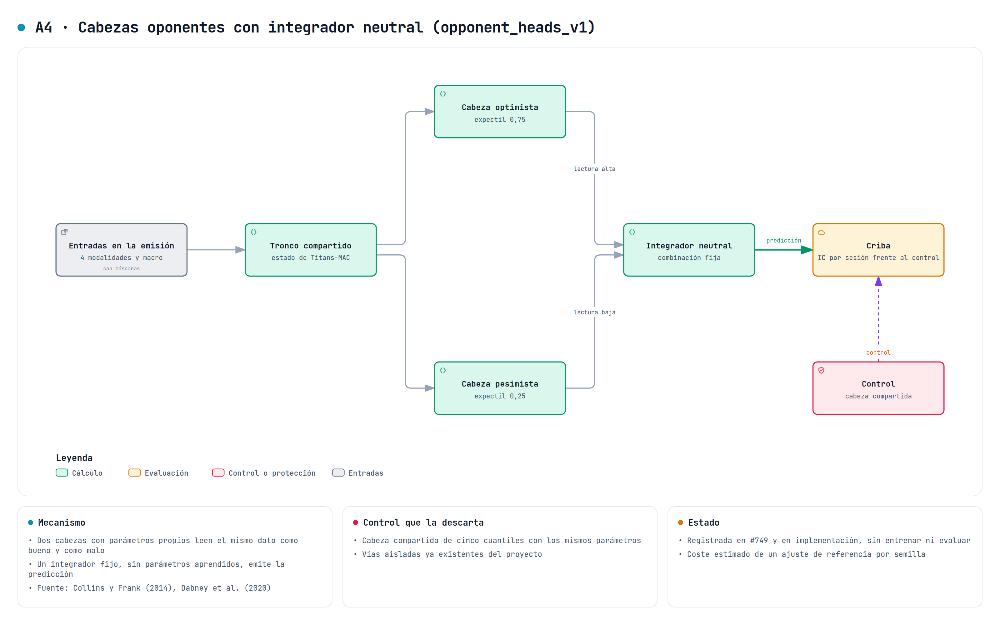

# Cabezas oponentes con integrador neutral

Este documento describe A4 del estudio de variantes de [#742](https://github.com/GonxKZ/mars-titan/issues/742), que se implementa en [#749](https://github.com/GonxKZ/mars-titan/issues/749). `opponent_heads_v1` es un componente opcional de `FinancialConfig` (`opponent_heads`) que sustituye la pérdida MAE de la cabeza escalar por dos cabezas con niveles asimétricos opuestos, una pesimista y otra optimista, y emite su media fija. Es un objetivo de salida del marco común de `output_objectives`, igual que F1 y el objetivo de IC por sesión, y no se puede declarar con ellos.

Está integrada en el predictor, en el recorrido cronológico y en el padre congelado. Se ha comprobado con pruebas en CPU sobre fixtures. La comprobación CUDA está pendiente porque la GPU está ocupada. No se ha entrenado ni evaluado con datos financieros y nada de lo que sigue es una mejora observada.



## Motivación y fuentes

La idea de partida es ver el mismo dato desde dos lados, uno que lo lee como bueno y otro como malo, con un observador neutral que no toma partido. Hay dos antecedentes que la concretan.

- [Dabney et al. (2020)](https://doi.org/10.1038/s41586-019-1924-6) observaron que las neuronas dopaminérgicas del área tegmental ventral de ratón escalan de forma distinta los errores de predicción positivos y negativos. Unas son optimistas y otras pesimistas, y en conjunto codifican la distribución de la recompensa y no solo su media. El modelo que proponen es el aprendizaje por refuerzo distribucional con expectiles.
- [Collins y Frank (2014)](https://doi.org/10.1037/a0037015) modelan los ganglios basales con dos actores oponentes, D1 y D2, que aprenden de forma asimétrica de los mismos errores y se combinan al elegir.

Los expectiles proceden de [Newey y Powell (1987)](https://doi.org/10.2307/1911031). Ninguna de estas fuentes propone un predictor financiero con dos cabezas y un integrador fijo. Esa traducción es propia del proyecto, y la hipótesis que se contrasta es concreta: ajustar el tronco compartido con las dos colas, en lugar de con una sola pérdida simétrica, da una representación que también mejora el punto emitido. Puede no hacerlo, y la declaración permite descartarla.

## Ecuaciones

Sea h el estado codificado que ya recibe la cabeza escalar. La cabeza escalar da el centro c y una proyección lineal nueva da la semiamplitud d:

$$c=\text{cabeza}(h),\qquad d=w^\top h+b_d,\qquad \text{pesimista}=c-d,\qquad \text{optimista}=c+d.$$

w y b_d empiezan en cero. Con u = y − cabeza y τ < 0,5 el nivel pesimista declarado, la pérdida es

$$\mathcal L=\frac1N\sum_i\Big[\rho_\tau(y_i-c_i+d_i)+\rho_{1-\tau}(y_i-c_i-d_i)\Big]$$

en una de dos familias:

$$\text{expectil: }\rho_\tau(u)=\lvert\tau-\mathbb 1(u<0)\rvert\,u^2,\qquad \text{cuantil: }\rho_\tau(u)=(\tau-\mathbb 1(u<0))\,u.$$

El integrador neutral emite (pesimista + optimista)/2 = c. Es fijo y no tiene parámetros.

Con d = 0 la suma de los dos niveles vale u² con expectiles y |u| con cuantiles, de modo que c recibe al empezar el gradiente del error cuadrático o del absoluto. Por fila, la derivada respecto a d en d = 0 vale −2|u|(1 − 2τ) con expectiles y −(1 − 2τ) con cuantiles si u ≠ 0. Es negativa para τ < 0,5, así que el descenso aumenta d y separa las cabezas. Con τ = 0,5 la derivada es exactamente cero en coma flotante y d no se mueve.

## Qué estima el integrador

El cambio (c, d) ↦ (c − d, c + d) es biyectivo y lineal. En el mínimo, cada cabeza alcanza su nivel y el centro estima

$$c^\*=\tfrac12\big(q_\tau+q_{1-\tau}\big),$$

con q los cuantiles o los expectiles condicionales de su familia. Con cuantiles y τ = 0,25 es el centro intercuartílico. Esto es una objeción seria, porque la selección y la comparación usan el MAE por sesión, cuyo óptimo es la mediana. c* solo coincide con la mediana cuando la distribución condicional es simétrica. Con un residuo asimétrico, A4 desplaza el punto emitido aunque el tronco aprenda mejor. La prueba `test_the_integrator_estimates_the_midpoint_of_both_levels_not_the_median` lo comprueba con una muestra exponencial en las dos familias: el mínimo conjunto está en los niveles τ y 1 − τ, y el centro se separa de la mediana y de la media.

## Controles

Cada familia tiene su propio control, las mismas cabezas con τ = 0,5. Así se separa el efecto de la asimetría del cambio de familia.

- Con cuantiles y τ = 0,5, c recibe exactamente el gradiente del error absoluto de la referencia y d queda en cero. El control reproduce la referencia y sirve como comprobación de paridad.
- Con expectiles y τ = 0,5, c se ajusta con el error cuadrático. Cambiar de L1 a L2 ya modifica la escala y la robustez del gradiente, así que la variante de expectiles se compara con este control y no con la referencia.

La [declaración](../../configs/experiments/opponent-heads-v1.json) parte de la receta histórica con máscaras, con la cabeza escalar y la pérdida `mae`. Tiene la referencia de error absoluto, los dos controles simétricos y las dos variantes con τ = 0,25. Todas son `mac_online`, están desactivadas por defecto y no acceden al test final. Una variante se descarta si su MAE por sesión no mejora al de su control con el contraste de la criba de [#746](https://github.com/GonxKZ/mars-titan/issues/746).

## Desviaciones y límites

- Dabney et al. usan muchas neuronas con un abanico de niveles y aprendizaje por diferencias temporales. Aquí hay dos niveles y una regresión supervisada sobre etiquetas maduras.
- De Collins y Frank solo se toma la idea de dos canales con asimetrías opuestas sobre el mismo error. OpAL actualiza los actores con una regla hebbiana y los combina para elegir una acción, algo que no ocurre aquí.
- El integrador es una media fija. Un integrador aprendido, que pudiera acercarse a la mediana, sería otro contraste con otra identidad.
- d no está restringida a ser positiva. Si las cabezas se cruzan en alguna fila, el punto emitido no cambia, pero las cabezas dejan de ser un intervalo. No se escriben en las predicciones, y por eso no se ha añadido una restricción.
- A4 se rechaza con la cabeza de cuantiles, con una receta distinta de `mae`, con destilación, en el postentrenamiento y en el ajuste Dust inicial, que no tienen todavía un contraste declarado. El lector episódico consume c como cualquier otro padre y no ajusta las cabezas. El objetivo declara `scalar_point`, porque su punto es la cabeza escalar sin transformar.

## Correspondencia entre ecuaciones, módulo y prueba

| Ecuación o regla | Módulo | Prueba |
| --- | --- | --- |
| Valor de ρ_τ(c − d) + ρ_{1−τ}(c + d) en las dos familias | `models/titans/opponent_heads.py`, `opponent_loss` | `test_value_matches_the_asymmetric_loss_of_each_head` |
| Gradientes de c y d iguales a los de la fórmula explícita | `opponent_loss` | `test_gradients_follow_autograd_of_the_explicit_formula`, con `gradcheck` en FP64 para expectiles |
| Con d = 0, la familia de cuantiles da el gradiente L1 y ∂L/∂d = −(1 − 2τ)/N | `opponent_loss` | `test_with_zero_spread_the_quantile_family_is_the_absolute_error_of_the_reference` |
| Con d = 0, la de expectiles da el gradiente L2 y ∂L/∂d = −2\|u\|(1 − 2τ)/N | `opponent_loss` | `test_with_zero_spread_the_expectile_family_is_the_squared_error_and_opens_the_heads` |
| c* = (q_τ + q_{1−τ})/2, distinto de la mediana con asimetría | `opponent_loss` | `test_the_integrator_estimates_the_midpoint_of_both_levels_not_the_median`, con `scipy.stats.expectile` |
| d = 0 al empezar, sin el generador global, y emisión de c | `OpponentSpread` | `test_the_spread_starts_at_zero_without_touching_the_global_generator` |
| El tronco ve la pérdida simétrica de su familia con d = 0 | `FinancialPredictor._prepare` | `test_at_zero_spread_the_trunk_sees_the_symmetric_loss_of_its_family` |
| Cada actualización usa las dos cabezas y, con cuantiles, el tronco conserva el gradiente L1 | `ChronologicalTrainer._task_loss` | `test_each_update_uses_both_heads_and_the_trunk_keeps_the_l1_gradient` |
| La firma del padre congelado incluye familia y nivel | `frozen_financial._module_settings` | `test_frozen_signature_separates_the_opponent_variant_from_its_control` |

Las pruebas del predictor están en `tests/models/titans/test_opponent_heads.py`, las del recorrido en `tests/training/test_financial_run_opponent_heads.py` y las del padre congelado en `tests/models/titans/test_frozen_scale_horizons.py`. El recorrido usa un optimizador que solo registra gradientes y no da pasos.

## Paridad, estado y recuperación

Sin declarar `opponent_heads`, `FinancialConfig.identity()` no cambia, el predictor no crea el módulo y `PreparedDecisions.outputs` vale None. Con las cabezas, la identidad registra `output` y `output_objective`, con familia, niveles y papel (`opponent_variant` o `symmetric_control`). Los parámetros de la referencia conservan sus valores iniciales con la misma semilla, el punto emitido coincide bit a bit y el generador global no avanza. `PreparedDecisions.outputs` contiene [c, d] por fila. Solo se añaden `output_objective.weight` y `output_objective.bias`, 65 parámetros con H = 64, que pertenecen al papel `shared` del optimizador. No hay estado por flujo y la semiamplitud viaja en el `state_dict` del checkpoint.

## Coste medido

La medida CPU del 28 de octubre usa 256 activos, ocho instantes con grafo, 64 sesiones de precios, 384 componentes de noticias, 512 de gráficos, 26 conceptos fundamentales y 140 indicadores macro. El predictor tiene H = 64 y la memoria de la receta histórica. Se usaron cuatro hilos, FP32 estricto, SDPA MATH, un calentamiento y siete repeticiones con orden rotatorio. El equipo tenía otras cargas, con una media de carga de un minuto de 7,7 al empezar y 6,5 al terminar. Son entradas sintéticas y ningún parámetro cambia. El [recibo](../../reports/engineering/opponent-heads-20261028/cost-256.json) conserva las muestras, las huellas de código y la carga.

| Modelo | Parámetros adicionales | Forward y pérdida | Backward | Inferencia de los ocho instantes |
| --- | ---: | ---: | ---: | ---: |
| Referencia MAE | 0 | 0,570 s | 0,364 s | 0,568 s |
| Control de cuantiles, τ = 0,5 | 65 | 0,598 s | 0,357 s | 0,551 s |
| Cuantiles, τ = 0,25 | 65 | 0,590 s | 0,367 s | 0,548 s |
| Control de expectiles, τ = 0,5 | 65 | 0,639 s | 0,385 s | 0,606 s |
| Expectiles, τ = 0,25 | 65 | 0,621 s | 0,352 s | 0,546 s |

Los tiempos son medianas. Las diferencias, de hasta un 12 % en el forward, quedan dentro de la variación entre repeticiones de cada modelo, que va de 0,46 s a 0,77 s. Las cabezas añaden una proyección de H a 2 por fila y el pico neto de ATen crece 24,8 kB sobre 504,9 MB. La ejecución, que mide también B3 y B4, duró 117,9 s y alcanzó 2,46 GB de RAM. No se han medido VRAM ni energía. Esta medida describe el coste técnico, no el de un entrenamiento ni su utilidad predictiva.

```bash
CUDA_VISIBLE_DEVICES=-1 uv run python -m benchmarks.objective_variants_cost \
  --rows 256 --instants 8 --repetitions 7 --warmup 1 --threads 4 \
  --output "${MARS_OBJECTIVE_COST:?}"
```

## Comprobación y trabajo pendiente

La comprobación del 28 de octubre se hizo en CPU, sin pasos de optimizador y con la GPU ocupada por otra carga.

- Las 49 pruebas dirigidas de A4 pasan con medida de cobertura. Con coverage 7.16.1 y radon 6.0.1, `opponent_heads.py` cubre 58/58 sentencias y 12/12 ramas, y `output_objectives.py` 38/38 y 20/20. El CRAP máximo es 13.
- La regresión de los 24 módulos que recorren estos cambios, incluida la guarda del bloqueo, pasa 566 casos y omite 29 por el bloqueo o por el enlace nativo. Fallan las cuatro variantes `gru_episodic` de `test_joint_stop_trainers.py`, porque el enlace episódico compilado no declara la versión tensorial del candidato. Fallan igual en develop y no pasan por A4.
- Doce mutaciones dirigidas se detectan con los controles en verde antes y después. Cubren el intercambio de los pesos asimétricos, la familia ignorada, las dos cabezas del mismo lado, la suma en lugar de la media, la semiamplitud inicial aleatoria, la emisión de la cabeza optimista, el nivel equivocado del control, los niveles por encima de 0,5, el objetivo sin registrar, la aceptación en el postentrenamiento, la firma congelada sin niveles y el entrenamiento con la pérdida de la referencia.

El [recibo de verificación](../../reports/engineering/opponent-heads-20261028/verification.json) conserva los recuentos y las huellas de los informes JUnit, de la cobertura y de las mutaciones.

Queda pendiente:

- La comprobación en `cuda:0`, que espera a que la GPU quede libre.
- La entrada de A4 en la criba de [#746](https://github.com/GonxKZ/mars-titan/issues/746), con el MAE por sesión frente a su control.
- Cualquier evaluación predictiva, que sigue bloqueada.
