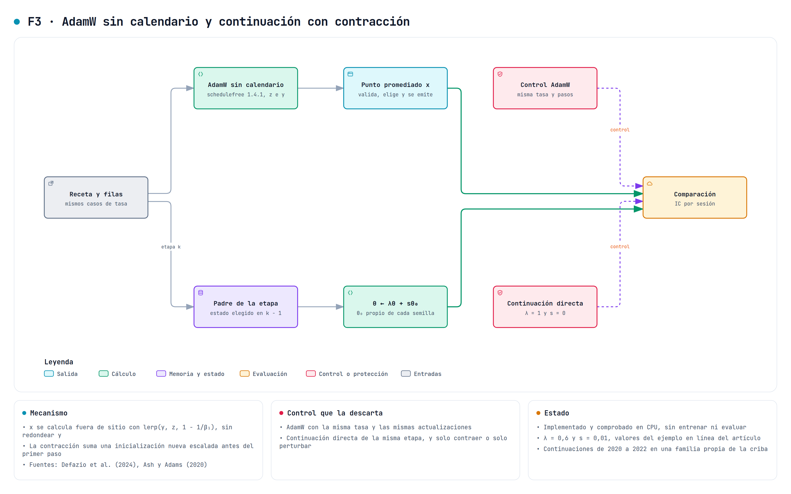

# AdamW sin calendario y continuación con contracción

Este documento describe F3 del estudio de variantes de [#742](https://github.com/GonxKZ/mars-titan/issues/742), que se implementa en [#749](https://github.com/GonxKZ/mars-titan/issues/749). F3 reúne dos cambios del ajuste que se contrastan por separado. `schedule_free_v1` sustituye AdamW por su versión sin calendario de tasa y se declara en la receta con `schedule_free`. `shrink_perturb_v1` contrae los pesos de una continuación y les suma una inicialización nueva escalada, y se declara con `shrink_perturb`. Los dos están desactivados por defecto.

Están integrados en `ChronologicalTrainer`, con recuperación y estado elegido. Se han comprobado en CPU sin pasos de optimizador. No se ha entrenado ni evaluado con datos financieros y nada de lo que sigue es una mejora observada.



## AdamW sin calendario

[Defazio et al. (2024)](https://arxiv.org/abs/2405.15682) proponen sustituir el calendario de la tasa por un promedio de iterados. El optimizador mantiene tres secuencias:

$$y_t=(1-\beta_1)\,z_t+\beta_1\,x_t,\qquad z_{t+1}=z_t-\gamma\,\tilde g(y_t),\qquad x_{t+1}=(1-c_{t+1})\,x_t+c_{t+1}\,z_{t+1},$$

con g̃ el gradiente normalizado por el segundo momento de Adam. El gradiente se calcula en y, mientras que x es el punto promediado que se evalúa. Con la tasa constante del control, sin calentamiento, r = 0 y weight_lr_power = 2, el peso es c_{t+1} = 1/(t + 1) y x es la media uniforme de los z, la de [Polyak y Juditsky (1992)](https://doi.org/10.1137/0330046).

La implementación usa `schedulefree.AdamWScheduleFree` 1.4.1, fijada en el extra `optimizers` del proyecto. La receta conserva su tasa y su decaimiento. `ScheduleFree.build` comprueba la versión instalada y deja el optimizador en modo de ajuste.

La biblioteca cambia entre y y x en su sitio con `optimizer.eval()` y `optimizer.train()`. Cada ida y vuelta redondea los pesos, y como el recorrido guarda estados a mitad de época según el reloj, el ajuste dependería del momento en que se guardara. Por eso el recorrido no llama nunca a `eval()`. `AveragedPoint` calcula x fuera de sitio con lerp(y, z, 1 − 1/β₁), la misma operación que hace `eval()`, y los pesos y se restauran por copia exacta. Una prueba fija z a mano y comprueba que el resultado coincide bit a bit con el que escribe `eval()`. Esta decisión depende del estado interno `z` de la versión fijada, y por eso la versión se comprueba al construir el optimizador.

La validación, el estado elegido y la emisión usan x, con el mismo intercambio que la media de pesos de [F2](seed-ema-ensemble-v1.md). El estado guarda x en `model` e y en `trained_model`, y la reanudación sigue con y.

## Continuación con contracción y ruido

[Ash y Adams (2020)](https://arxiv.org/abs/1910.08475) observaron que continuar el ajuste desde unos pesos ya entrenados generaliza peor que empezar de cero, y que contraer los pesos y añadir ruido al empezar reduce esa diferencia. Antes del primer paso de una ejecución nueva, cada parámetro ajustable pasa a

$$\theta\leftarrow\lambda\,\theta+s\,\theta_0,$$

con θ₀ el mismo parámetro de una inicialización nueva del predictor. Así el ruido sigue la distribución de inicialización de cada tipo de parámetro. La semilla de θ₀ se deriva con `SeedSequence` de NumPy a partir de la semilla declarada y de la del ajuste, de modo que cada semilla de ajuste recibe su propia inicialización nueva. Con la semilla declarada sin más, las cinco semillas de la criba compartirían el mismo θ₀ y la media entre semillas mediría el efecto de esa única extracción en lugar del método. θ₀ se construye con el generador aislado del predictor, sin consumir el generador global, y el recorrido rechaza una semilla derivada igual a la del ajuste. El informe registra esa semilla, las huellas de los pesos antes y después y la de θ₀. La reanudación no vuelve a aplicar la transformación, porque el estado guardado ya la contiene.

La declaración usa λ = 0,6 y s = 0,01, los valores del ejemplo de aprendizaje en línea del artículo, y separa dos contrastes adicionales: solo contraer (s = 0) y solo perturbar (λ = 1). λ = 1 y s = 0 deja el padre intacto y es el control.

## Controles

La [declaración](../../configs/experiments/schedule-free-shrink-perturb-v1.json) parte de la receta histórica con máscaras y sus dos casos de tasa.

- `schedule_free` se compara con AdamW (`adamw_reference`) con la misma tasa, el mismo decaimiento y las mismas actualizaciones.
- `shrink_perturb`, `shrink_only` y `perturb_only` solo se aplican a una etapa del walk-forward que empieza desde su padre. Su control es la continuación directa (`continuation_control`) de la misma etapa.

Una variante se descarta si su IC por sesión no supera al de su control con el contraste y la familia de la [criba](variant-screening-v1.md) de [#746](https://github.com/GonxKZ/mars-titan/issues/746).

## Continuación en la criba

`run_titans_window` acepta con `initial` la carpeta de una ventana completada de la misma variante y semilla en un origen anterior. Antes de abrir la vista comprueba que el padre es una ventana de Titans-MAC completada, sin abrir el test final, con la misma semilla, y que su validación acaba antes de que empiece la validación de la nueva ventana. Esa validación es la última información que pudo influir en el estado elegido del padre. Después verifica sus predicciones confirmadas, lee el estado elegido con la identidad de su ajuste y su huella y lo carga en el predictor nuevo. Como en el traslado de la variante B, solo pueden cambiar las huellas de la entrada. Arquitectura, cabeza, semilla y variante tienen que ser las del padre. La petición guarda la ejecución del padre y la huella de su estado, y la identidad del ajuste parte de esos pesos. El optimizador empieza de cero y la contracción se aplica una vez sobre los pesos del padre. Una receta con `shrink_perturb` sin padre se rechaza, igual que una continuación con control local o con emparejamiento.

En la criba, cada continuación del origen k empieza en el estado que `adamw_reference`, el mismo trabajo que la referencia B, eligió con la época común en el origen k − 1 con la misma semilla. 2019 no tiene padre, así que los cuatro modelos de continuación suman 60 ajustes de 2020 a 2022. Cada trabajo espera al de su padre y el motor le entrega su carpeta. Sus tres contrastes con la continuación directa forman una familia propia sobre las sesiones de esos tres años, con la misma regla de decisión, fuera de la familia declarada y de sus sensibilidades. Así la familia declarada conserva las sesiones de los cuatro orígenes. La continuación directa y la contracción completa frente al ajuste desde cero solo se publican.

## Desviaciones y límites

- La tasa del control es constante y la del optimizador sin calendario también. El artículo recomienda calentamiento y suele usar tasas mayores que AdamW. Aquí se mantiene la tasa de la receta para no cambiar dos cosas a la vez, y `warmup_steps` queda declarado a cero.
- El optimizador sin calendario y la media de pesos de F2 promedian iterados los dos. Combinarlos se rechaza.
- La contracción y el decaimiento anclado al padre tiran en sentidos opuestos, y la combinación se rechaza. También se rechaza con el control local, cuyo predictor no se puede reconstruir solo con la configuración, y con una semilla de θ₀ igual a la del ajuste.
- Cada continuación de la criba ajusta solo los doce meses de su origen, con un optimizador nuevo, y no acumula los datos de las etapas anteriores. Parte del estado que la época común eligió para el padre, no del último.
- La familia de continuación se evalúa aparte, así que el nivel del 5 % se controla dentro de cada familia. Para el conjunto de las dos familias, la desigualdad de Bonferroni solo acota el error por la suma de sus niveles. La familia tiene un año menos que la declarada.
- Ninguna de las dos tiene todavía un contraste declarado en el postentrenamiento, donde se rechazan.
- Ash y Adams estudian clasificación de imágenes con datos que llegan por bloques. Que la contracción ayude en una continuación financiera es la hipótesis que se contrasta.

## Correspondencia entre ecuaciones, módulo y prueba

| Regla | Módulo | Prueba |
| --- | --- | --- |
| Optimizador de la versión fijada en modo de ajuste, con la tasa de la receta | `training/schedule_free.py`, `ScheduleFree.build` | `test_build_uses_the_pinned_library_in_train_mode_with_the_recipe_rate` |
| x = lerp(y, z, 1 − 1/β₁), igual a lo que escribe `eval()`, sin modificar y | `AveragedPoint.emitted` | `test_the_averaged_point_is_what_eval_writes_and_leaves_y_untouched` |
| Otra versión de la biblioteca se rechaza | `ScheduleFree.build` | `test_another_library_version_is_rejected` |
| θ ← λθ + sθ₀ | `training/shrink_perturb.py`, `shrink_perturb` | `test_the_update_is_shrink_times_parent_plus_noise_times_fresh` |
| Una sola vez, con θ₀ de otra semilla y sin consumir el generador global | `ChronologicalTrainer._start_weights` | `test_shrink_and_perturb_applies_once_with_a_fresh_initialization` |
| Semilla de θ₀ propia de cada semilla de ajuste | `ShrinkPerturb.fresh_seed` | `test_each_fit_seed_receives_its_own_reproducible_fresh_seed` |
| La continuación empieza en el estado elegido de un padre anterior de su semilla | `titans_walk_forward.run_titans_window` con `initial` | `test_a_continuation_starts_from_the_chosen_state_of_its_parent` |
| La contracción solo existe como continuación de `mac_online` | `run_titans_window` | `test_the_shrink_of_f3_only_runs_as_a_continuation_of_mac_online` |
| Continuaciones sin trabajo en 2019 y familia propia en el análisis | `variant_screening.screening_jobs` y `variant_screening_analysis.continuation_family` | `test_the_continuations_start_from_the_reference_of_the_previous_origin` y `test_the_continuations_form_their_own_family_without_the_first_origin` |
| La validación y el estado usan x, y la reanudación sigue con y | `ChronologicalTrainer` | `test_the_run_validates_and_keeps_the_emitted_weights` y `test_resume_restores_the_trained_weights_and_reproduces_the_run` |
| Combinaciones sin contraste declarado | `ChronologicalRecipe.weight_options` | `test_partial_or_combined_options_are_rejected` |

## Paridad e identidad

Sin declarar ninguna de las dos opciones, la identidad de la receta conserva su forma y su optimizador `AdamW`. Con `schedule_free`, la receta registra el optimizador `AdamWScheduleFree`, la biblioteca, sus valores y la regla del punto emitido, y el recorrido comprueba que el optimizador construido es ese. Con `shrink_perturb`, la receta registra λ, s, la semilla declarada, la regla que deriva la de cada ajuste y su alcance. En ambos casos la identidad del recorrido añade la huella del módulo correspondiente. Una ventana sin `initial` conserva la forma de su petición. Las pruebas del recorrido usan un doble con la forma de `AdamWScheduleFree` que fija z a mano en cada llamada, sin modificar pesos.

## Coste medido

La medida CPU del 28 de octubre usa el predictor de la receta histórica con H = 64, 185.859 parámetros ajustables y las entradas sintéticas de 256 activos y ocho instantes de `objective_variants_cost`. Se usaron cuatro hilos, FP32 estricto, SDPA MATH, dos calentamientos y siete repeticiones. El equipo tenía otras cargas, con una media de carga de un minuto de 7,5 al empezar y al terminar. Ningún parámetro del predictor cambia, y se comprueba al final. El [recibo](../../reports/engineering/weight-options-20261028/cost-256.json) es común a F2 y F3 y conserva las muestras, las huellas de código y la carga.

| Operación | Mediana | Cuándo ocurre |
| --- | ---: | --- |
| Cálculo fuera de sitio del punto x | 0,25 ms | En cada validación |
| Intercambio de pesos de una validación con x, con los dos sellados | 3,6 ms | En cada validación |
| Contracción y ruido, incluida la construcción del predictor nuevo | 5,3 ms | Una vez por ejecución |
| Derivación de la semilla de θ₀ | 15 µs | Una vez por ejecución |
| Inferencia sin grafo de los ocho instantes | 0,64 s | Referencia de lo que cuesta una validación |

La derivación de la semilla se midió aparte el mismo día sobre el commit d85d26601, con un hilo y siete repeticiones de 10.000 llamadas tras 1.000 de calentamiento, con una carga media de 11 en el último minuto. Su [recibo](../../reports/engineering/f3-continuation-20261028/seed-derivation-cost.json) guarda las siete muestras, de 14 a 24 µs por llamada. Las demás filas son del recibo anterior a la derivación. Con el optimizador sin calendario, cada estado guardado crece 743 kB porque añade los pesos del ajuste. Su estado de optimizador guarda z y el segundo momento, tantos tensores como los dos momentos de AdamW. La contracción no añade estado. No se ha medido el coste de un paso del optimizador sin calendario frente a AdamW, porque la medida no ejecuta pasos. No se han medido VRAM ni energía.

```bash
CUDA_VISIBLE_DEVICES=-1 uv run --extra optimizers python -m benchmarks.weight_options_cost \
  --rows 256 --instants 8 --repetitions 7 --threads 4 \
  --output "${MARS_WEIGHT_OPTIONS_COST:?}"
```

## Comprobación y trabajo pendiente

La comprobación del 28 de octubre se hizo en CPU, sin pasos de optimizador y con la GPU ocupada por otra carga. Es común a F2 y F3.

- La regresión de los 30 módulos que recorren estos cambios, incluida la guarda del bloqueo, ejecutó 645 casos. Pasaron 616 y se omitieron 15. De los 14 fallos, cuatro son las variantes `gru_episodic` de `test_joint_stop_trainers.py`, que fallan igual en develop porque el enlace episódico compilado no declara la versión tensorial del candidato. Cinco casos se detuvieron porque el código cambió durante el recorrido, tres pruebas de F1 no coincidían con el código de ese momento y dos casos de la guarda señalaban una prueba nueva de develop que usaba un doble del bloqueo sin declararlo en el inventario. Todos esos casos pasan al repetirlos sobre el árbol final.
- La repetición de los cinco módulos con fallos pasa 91 de sus 95 casos. Solo fallan las cuatro variantes `gru_episodic`.
- Tras integrar A4 y el análisis de la criba de develop, las pruebas de F2, F3 y sus recorridos, de F1, de A4, del coste y de la guarda del bloqueo pasan 165 casos y omiten la prueba CUDA.
- Con coverage 7.16.1 y radon 6.0.1, los cuatro módulos nuevos cubren 164 de 165 sentencias y 61 de 62 ramas. `weight_averaging.py`, `schedule_free.py` y `shrink_perturb.py` quedan cubiertos por completo, y `seed_ensemble.py` deja una sentencia y una rama sin recorrer. El CRAP máximo es 25,0, en `seed_mean`, cuya complejidad es 25.
- Catorce mutaciones dirigidas se detectan con los controles en verde antes y después. Cubren la sombra sin actualizar, la validación con los pesos del ajuste, la reanudación y el guardado con los pesos emitidos, la contracción repetida al reanudar, otro optimizador aceptado, las dos medias a la vez, la identidad sin la opción, el ruido equivocado de la contracción, la media móvil con el complemento, los pesos emitidos sin restaurar, el punto x con el peso del ajuste o calculado en sitio y las semillas en orden de llegada. Se ejecutaron antes de integrar A4, que cambió `financial_run.py`, y las pruebas que matan sus casos pasan después.

El [recibo de verificación](../../reports/engineering/weight-options-20261028/verification.json) conserva los recuentos y las huellas de los informes JUnit, de la cobertura y de las mutaciones.

La continuación desde el padre y su familia en la criba se comprobaron después, también en CPU y sin pasos de optimizador, sobre el commit d85d26601.

- Las pruebas de la contracción, del recorrido, de la ventana con padre, del motor, del análisis y de la orden de la criba y de la guarda del bloqueo pasan 471 casos con cobertura de ramas. Se omiten dos por el bloqueo de aprendizaje y se deselecciona la prueba CUDA.
- La regresión de los 51 módulos que importan los cambios pasa 1.092 casos y omite 18, todos por el bloqueo de aprendizaje.
- Las 94 líneas ejecutables cambiadas están cubiertas. El CRAP máximo de las funciones cambiadas es 89,2, en `ChronologicalTrainer.__init__`, cuya complejidad de 69 ya existía y que no tiene líneas ejecutables cambiadas. El de los seis módulos medidos es 240, en `ChronologicalTrainer._auxiliary` de F5, que estas pruebas no recorren y que no cambia.
- Veintisiete mutaciones dirigidas se detectan con los controles en verde antes y después. Cubren la semilla de θ₀ que ignora la del ajuste o la acepta fuera de rango, la contracción sin padre, el padre de la misma ventana, de otra semilla, en pausa, sin predicciones verificadas o sin cargar, la continuación en el primer origen o desde el mismo origen, el motor que no espera al padre y la familia de continuación perdida o mezclada con las demás.
- `ruff`, el formato y `scripts/check_repository.py` pasan sobre el mismo árbol.

Su [recibo de verificación](../../reports/engineering/f3-continuation-20261028/verification.json) conserva los recuentos, las huellas de los informes, el CRAP de las funciones cambiadas y las mutaciones.

Queda pendiente:

- La comprobación en `cuda:0`, que espera a que la GPU quede libre.
- La ejecución de la criba, que espera la decisión sobre su presupuesto y la aprobación del bloqueo de aprendizaje.
- Cualquier evaluación predictiva, que sigue bloqueada.
