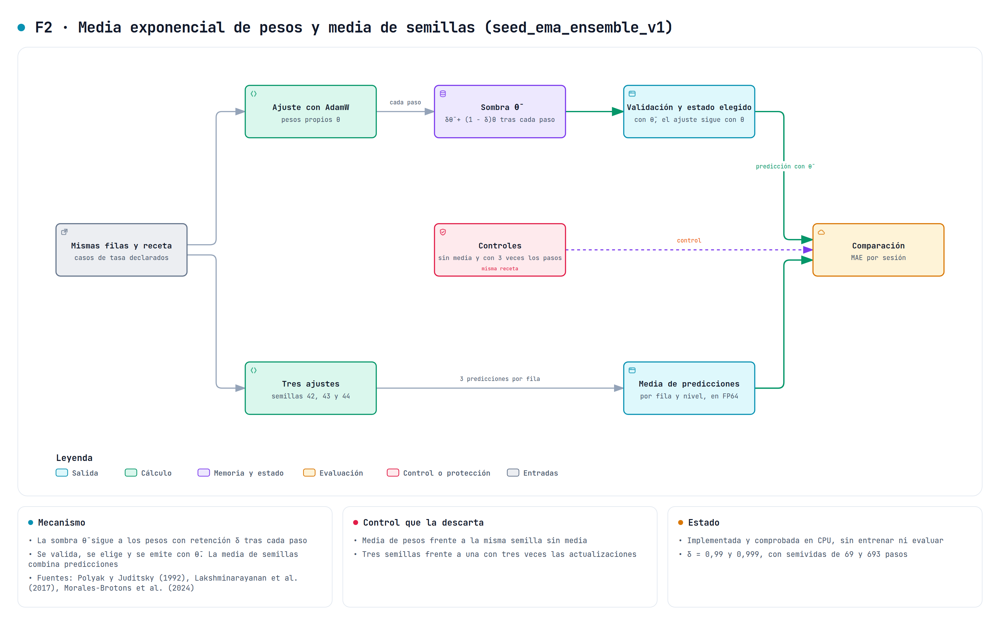

# Media exponencial de pesos y media de semillas

Este documento describe F2 del estudio de variantes de [#742](https://github.com/GonxKZ/mars-titan/issues/742), que se implementa en [#749](https://github.com/GonxKZ/mars-titan/issues/749). `seed_ema_ensemble_v1` tiene dos partes independientes. La media exponencial de pesos (`weight_ema_v1`) se declara en la receta cronológica con `weight_average` y cambia los pesos con que se valida, se elige y se emite cada ajuste. La media de semillas (`seed_mean_v1`) combina las predicciones ya emitidas por varios ajustes que solo difieren en la semilla. Las dos están desactivadas por defecto.

La media de pesos está integrada en `ChronologicalTrainer`, con recuperación y estado elegido. La media de semillas es una función de evaluación sobre las tablas de predicciones. Se han comprobado en CPU sin pasos de optimizador. No se ha entrenado ni evaluado con datos financieros y nada de lo que sigue es una mejora observada.



## Motivación

El [control de varianza entre semillas](../../src/mars_titan/evaluation/seed_variance_control.py) de #459 se diseñó porque, con una señal tan débil, cambiar solo la semilla mueve el MAE por sesión tanto como una propuesta. Las dos partes de F2 atacan esa varianza desde lados distintos. La media de pesos reduce la del recorrido de un ajuste y la media de semillas la de la inicialización y el orden de los cálculos. Ninguna corrige un sesgo común a todas las semillas.

## Media exponencial de pesos

Tras cada paso del optimizador, cada parámetro ajustable θ actualiza su sombra

$$\bar\theta\leftarrow\delta\,\bar\theta+(1-\delta)\,\theta,\qquad \bar\theta=\theta\ \text{al empezar}.$$

La actualización usa `torch.optim.swa_utils.get_ema_multi_avg_fn`, la misma función pública que emplea `AveragedModel`, sobre los parámetros que recibe el optimizador. No se copia el predictor entero. El promedio de iterados procede de [Polyak y Juditsky (1992)](https://doi.org/10.1137/0330046). La forma exponencial es la de PyTorch, y [Morales-Brotons, Vogels y Hendrikx (2024)](https://arxiv.org/abs/2411.18704) estudian su efecto en redes profundas.

La sombra cambia tres cosas del recorrido:

- **Validación.** Antes de validar se copian las sombras sobre los parámetros, se vuelve a sellar el predictor y al terminar se restauran los pesos propios por copia exacta, también si la validación falla o se pausa. El ajuste continúa con sus propios pesos.
- **Estado guardado.** `model` contiene las sombras y `trained_model` los pesos del ajuste. `weight_average` guarda las sombras y su contador. Los consumidores del estado elegido, como el traslado entre etapas del walk-forward, la inferencia de una ventana o el padre congelado, leen `model` y predicen con la media sin conocer este módulo.
- **Reanudación.** Se cargan `trained_model` y las sombras guardadas. La prueba de reanudación usa una sombra distinta de los pesos y comprueba que el recorrido interrumpido reproduce bit a bit los gradientes del continuo.

La declaración prueba dos retenciones. Con δ = 0,99 la semivida es de 69 actualizaciones y con δ = 0,999 de 693. Una época del piloto v4 de plasticidad, con el tramo de ajuste 2000-2022, hizo 685 actualizaciones, unas 31 por año de datos. En un experimento acotado de un año y 30 épocas, δ = 0,999 promedia casi todo el ajuste y arrastra los pesos iniciales, mientras que δ = 0,99 abarca unas dos épocas. La elección entre ambas se hace con la validación de la criba.

## Media de semillas

`seed_mean` recibe de 2 a 16 tablas de predicciones identificadas por su semilla. Exige el mismo esquema, las mismas filas y las mismas columnas `sample_id`, `asset_id`, `market`, `prediction_at`, `target` y `zero`, y valores FP64 finitos. Ordena las semillas, suma en FP64 en ese orden y divide entre K, de modo que el resultado no depende del orden en que lleguen. Con la cabeza de cuantiles promedia cada nivel por separado. Es la media de funciones cuantil de Vincent, descrita por [Ratcliff (1979)](https://doi.org/10.1037/0033-2909.86.3.446), que conserva el orden de los niveles. No son los cuantiles de la mezcla de las K distribuciones. Los conjuntos de redes con distinta inicialización proceden de [Lakshminarayanan, Pritzel y Blundell (2017)](https://arxiv.org/abs/1612.01474), que además entrenan con reglas de puntuación propias y entrenamiento adversarial, algo que aquí no se hace.

## Controles

La [declaración](../../configs/experiments/seed-ema-ensemble-v1.json) parte de la receta histórica con máscaras y sus dos casos de tasa de aprendizaje.

- La media de pesos se compara con la misma semilla sin media (`single_seed_reference`), con las mismas actualizaciones.
- La media de tres semillas (42, 43 y 44) cuesta tres ajustes. Su control es una sola semilla con tres veces las actualizaciones (`single_seed_matched_updates`). El protocolo del walk-forward fija el máximo de épocas, así que el protocolo de la criba de [#746](https://github.com/GonxKZ/mars-titan/issues/746) debe traducir `updates_multiplier` a épocas antes de ejecutar.

Una variante se descarta si su MAE por sesión no mejora al de su control con el contraste de la criba.

## Desviaciones y límites

- La sombra solo promedia los parámetros del optimizador externo. Los pesos rápidos de la memoria de Titans son estado por flujo y no se promedian. El predictor normaliza con LayerNorm y no tiene estadísticas de lote que recalcular.
- El arranque no se corrige. La sombra empieza en los pesos iniciales y, con δ alta, las primeras validaciones los conservan casi intactos.
- En un walk-forward con cambios de régimen, la media puede retrasar la adaptación de cada etapa. Es una objeción que solo la comparación puede resolver.
- F2 se rechaza junto al optimizador sin calendario de F3, que ya promedia iterados, y en el postentrenamiento, que no tiene todavía un contraste declarado.
- La media de semillas reduce varianza, no sesgo. Si todas las semillas comparten el mismo error, el conjunto lo conserva.

## Correspondencia entre ecuaciones, módulo y prueba

| Regla | Módulo | Prueba |
| --- | --- | --- |
| θ̄ ← δθ̄ + (1 − δ)θ en cada actualización | `training/weight_averaging.py`, `ShadowWeights.update` | `test_each_update_follows_the_declared_recursion` |
| Intercambio temporal y restauración exacta, también tras un error | `weight_averaging.applied` | `test_applied_swaps_the_weights_and_restores_them_even_after_an_error` |
| Una actualización de la sombra por paso confirmado | `ChronologicalTrainer._update` | `test_the_shadow_follows_every_update_of_the_run` |
| La validación del recorrido es la de los pesos emitidos | `ChronologicalTrainer._emitted_weights` | `test_the_run_validates_and_keeps_the_emitted_weights` |
| `model` emitido y `trained_model` del ajuste en el estado | `ChronologicalTrainer._model_states` | `test_validation_and_the_saved_model_use_the_emitted_weights` |
| La reanudación sigue con los pesos del ajuste | `ChronologicalTrainer.run` | `test_resume_restores_the_trained_weights_and_reproduces_the_run` |
| Media por fila en FP64 con orden fijo de semillas | `evaluation/seed_ensemble.py`, `seed_mean` | `test_the_order_of_the_seeds_does_not_change_a_single_bit` |
| Media por nivel de los cuantiles, que conserva su orden | `seed_mean` | `test_quantile_levels_are_averaged_and_stay_ordered` |

## Paridad e identidad

Sin declarar `weight_average`, la identidad de la receta conserva su forma, el recorrido no crea sombras y el estado guarda solo `model`. Con la media, la receta registra la configuración y su semivida, y la identidad del recorrido añade la huella de `weight_averaging.py`. Las pruebas usan un optimizador que registra gradientes sin modificar pesos. Para que la sombra difiera de los pesos sin ajustar nada, se fija a mano o se sustituye su actualización por una suma constante.

## Coste medido

La medida CPU del 28 de octubre usa el predictor de la receta histórica con H = 64, 185.859 parámetros ajustables y las entradas sintéticas de 256 activos y ocho instantes de `objective_variants_cost`. Se usaron cuatro hilos, FP32 estricto, SDPA MATH, dos calentamientos y siete repeticiones, 140 en la actualización de la sombra. El equipo tenía otras cargas, con una media de carga de un minuto de 7,5 al empezar y al terminar. Ningún parámetro del predictor cambia, y se comprueba al final. El [recibo](../../reports/engineering/weight-options-20261028/cost-256.json) es común a F2 y F3 y conserva las muestras, las huellas de código y la carga.

| Operación | Mediana | Cuándo ocurre |
| --- | ---: | --- |
| Actualización de la sombra | 0,08 ms | Tras cada paso del optimizador |
| Intercambio de pesos de una validación, con los dos sellados | 2,5 ms | En cada validación |
| Inferencia sin grafo de los ocho instantes | 0,64 s | Referencia de lo que cuesta una validación |

La sombra ocupa 743 kB, lo mismo que los pesos, y cada estado guardado con F2 crece 1,49 MB porque añade los pesos del ajuste y las sombras. La ejecución duró 7,1 s y alcanzó 0,91 GB de RAM. La media de semillas no se ha medido aquí. Su coste dominante no es la media, sino los tres ajustes que exige, y su control con tres veces las actualizaciones cuesta lo mismo. No se han medido VRAM ni energía.

```bash
CUDA_VISIBLE_DEVICES=-1 uv run --extra optimizers python -m benchmarks.weight_options_cost \
  --rows 256 --instants 8 --repetitions 7 --threads 4 \
  --output "${MARS_WEIGHT_OPTIONS_COST:?}"
```

## Comprobación y trabajo pendiente

La comprobación del 28 de octubre se hizo en CPU, sin pasos de optimizador y con la GPU ocupada por otra carga. Es común a F2 y F3.

- La regresión de los 30 módulos que recorren estos cambios, incluida la guarda del bloqueo, ejecutó 645 casos. Pasaron 616 y se omitieron 15. De los 14 fallos, cuatro son las variantes `gru_episodic` de `test_joint_stop_trainers.py`, que fallan igual en develop porque el enlace episódico compilado no declara la versión tensorial del candidato. Cinco casos se detuvieron porque el código cambió durante el recorrido, tres pruebas de F1 no coincidían con el código de ese momento y dos casos de la guarda señalaban una prueba nueva de develop que usaba un doble del bloqueo sin declararlo en el inventario. Todos esos casos pasan al repetirlos sobre el árbol final.
- La repetición de los cinco módulos con fallos pasa 91 de sus 95 casos. Solo fallan las cuatro variantes `gru_episodic`.
- Tras integrar A4 y el análisis de la criba de develop, las pruebas de F2, F3 y sus recorridos, de F1, de A4, del coste y de la guarda del bloqueo pasan 165 casos y omiten la prueba CUDA.
- Con coverage 7.16.1 y radon 6.0.1, los cuatro módulos nuevos cubren 164 de 165 sentencias y 61 de 62 ramas. `weight_averaging.py`, `schedule_free.py` y `shrink_perturb.py` quedan cubiertos por completo, y `seed_ensemble.py` deja una sentencia y una rama sin recorrer. El CRAP máximo es 25,0, en `seed_mean`, cuya complejidad es 25.
- Catorce mutaciones dirigidas se detectan con los controles en verde antes y después. Cubren la sombra sin actualizar, la validación con los pesos del ajuste, la reanudación y el guardado con los pesos emitidos, la contracción repetida al reanudar, otro optimizador aceptado, las dos medias a la vez, la identidad sin la opción, el ruido equivocado de la contracción, la media móvil con el complemento, los pesos emitidos sin restaurar, el punto x con el peso del ajuste o calculado en sitio y las semillas en orden de llegada. Se ejecutaron antes de integrar A4, que cambió `financial_run.py`, y las pruebas que matan sus casos pasan después.

El [recibo de verificación](../../reports/engineering/weight-options-20261028/verification.json) conserva los recuentos y las huellas de los informes JUnit, de la cobertura y de las mutaciones.

Queda pendiente:

- La comprobación en `cuda:0`, que espera a que la GPU quede libre.
- La entrada de F2 en la criba de [#746](https://github.com/GonxKZ/mars-titan/issues/746), con la media de semillas como etapa de salida frente a un control con tantas actualizaciones como ajustes combina.
- Cualquier evaluación predictiva, que sigue bloqueada.
