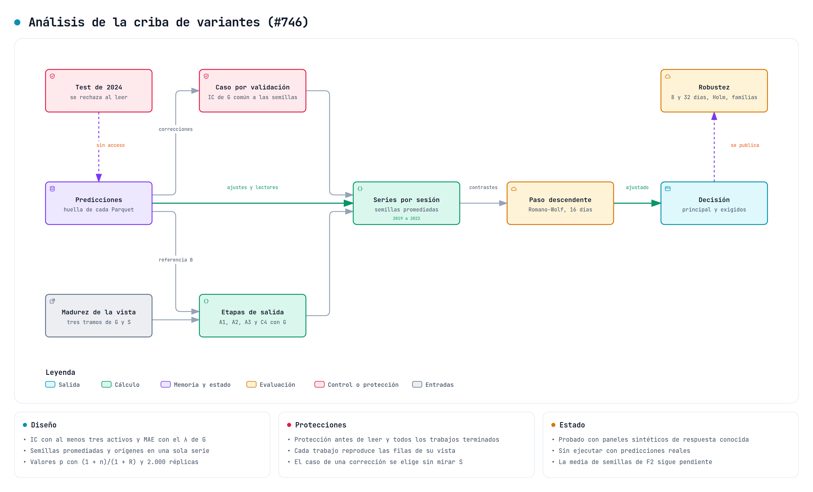

# Protocolo de la criba de variantes

Este documento registra el protocolo de la criba del estudio de variantes de [#742](https://github.com/GonxKZ/mars-titan/issues/742), que se implementa en [#746](https://github.com/GonxKZ/mars-titan/issues/746). Se fija antes de abrir ningún dato de S. La [declaración](../../configs/experiments/variant-screening-v1.json) contiene todos los valores y el [motor](../../benchmarks/variant_screening_study.py) la lee sin admitir cambios a mitad de la criba.

Nada de lo descrito se ha ejecutado. La protección del aprendizaje sigue activa, el test de 2024 sigue cerrado y la GPU solo se usará cuando quede libre. Las cifras de coste son estimaciones a partir de pilotos anteriores.

## Pregunta

La criba responde a una pregunta acotada: qué mecanismos del catálogo mejoran a su propio control con los mismos datos, filas, semillas y presupuesto. No confirma una mejora. Una variante que pase la criba necesita la confirmación de la fase 2, con 2023, 128 activos y China por separado, que requiere otra aprobación.

La fase 0 ([#744](https://github.com/GonxKZ/mars-titan/issues/744)) encontró que ningún predictor de los pilotos tenía un IC por sesión distinguible de cero con 64 activos y que la amplitud de las predicciones explicaba la pérdida frente a cero. Por la regla declarada antes de aquel cálculo, el contraste principal pasa a ser el IC por sesión y la población, 256 activos de EE. UU.

## Población y orígenes

Cada origen tiene su propia cohorte de 256 activos, elegida con la regla de [`screening_cohorts`](../engineering/screening-origin-cohorts.md): huella SHA-256 con sal fija entre los activos con alguna etiqueta de ajuste anterior al origen. Ni el objetivo ni la cobertura futura intervienen en la elección.

| Origen | Vista | Ajuste (12 meses) | Validación | Calibración | S |
| --- | --- | --- | --- | --- | --- |
| 2019 | `fold-014` | abr. 2017 a mar. 2018 | abr. a sep. 2018 | oct. a dic. 2018 | 2019 |
| 2020 | `fold-015` | abr. 2018 a mar. 2019 | abr. a sep. 2019 | oct. a dic. 2019 | 2020 |
| 2021 | `fold-016` | abr. 2019 a mar. 2020 | abr. a sep. 2020 | oct. a dic. 2020 | 2021 |
| 2022 | `fold-017` | abr. 2020 a mar. 2021 | abr. a sep. 2021 | oct. a dic. 2021 | 2022 |

El ajuste usa los doce meses finales del tramo de entrenamiento de cada vista (`fit_months = 12`), que nunca superan 366 días. Antes del ajuste el modelo observa sin etiquetas sus meses de calentamiento, como en el resto del walk-forward. La validación elige la época común de cada grupo de semillas y la calibración fija λ, las correcciones conformales, los umbrales y las etapas de salida. Juntas forman G. La evaluación de cada origen es su bloque de S, y los cuatro años de 2019 a 2022 forman una única serie de unas 1.000 sesiones. Los trimestres de cada año son los bloques de meses que usarán más adelante los ciclos de autoedición.

E es 2023 (`fold-018`). La criba no lo abre. Es un año de desarrollo reutilizado, porque los pilotos de octubre y la fase 0 ya lo evaluaron con otros predictores, y así se indicará en cualquier confirmación.

Las sesiones de 2019 son S del origen 2019 y, a la vez, ajuste, validación y calibración del origen 2020. No es una fuga. Cada origen elige su estado con su propia G, y ningún veredicto usa las filas con las que se eligió el modelo que juzga.

## Ajuste

Todos los ajustes parten de su receta declarada con estos cambios comunes:

- 12 épocas que cada ajuste recorre enteras. Todas las semillas emiten el estado de la época común del grupo, elegida con el IC por sesión de la validación como describe la sección siguiente. Con 256 activos, unas 250 sesiones de ajuste y bloques de 1.024 filas, son unas 740 actualizaciones, del orden de las 685 de los pilotos de octubre. La receta histórica declara 30 épocas sobre todo el tramo desde 2000, y aquí el tramo es de un año.
- Un caso de búsqueda, `lr1e-3`, el de los pilotos. Las correcciones B6 recorren todos los casos de su receta y eligen el suyo con la validación en el análisis.
- Cinco semillas, de 42 a 46.
- FP32 estricto, sin TF32 ni BF16, y SDPA con el backend matemático.

Los controles emparejados conservan el mismo número de actualizaciones. La única excepción declarada es el control de la media de semillas de F2, una sola semilla con tres veces las actualizaciones, que se traduce en 36 épocas con su propia vista.

## Selección del estado

La regla se enmendó el 28 de octubre, antes de abrir S, y la declaración guarda la fecha, el motivo y la regla anterior. Hasta entonces cada semilla emitía la época de menor MAE por sesión de su validación. El contraste principal se juzga con el IC por sesión, y la fase 0 mostró que la amplitud de las predicciones explicaba la pérdida frente a cero, así que el MAE de un residuo diario puede preferir épocas con predicciones pequeñas que apenas ordenan los activos. Además, quedarse con el mínimo de doce valores ruidosos en cada semilla sobreajusta la propia selección, porque la varianza del criterio importa tanto como su sesgo ([Cawley y Talbot, 2010](https://www.jmlr.org/papers/v11/cawley10a.html)). La regla de selección forma parte de lo que se compara ([Gulrajani y Lopez-Paz, 2021](https://arxiv.org/abs/2007.01434)), así que todos los modelos usan la misma y queda fijada antes de mirar S.

La regla `common_epoch_session_ic_v1` se aplica a los ajustes y a los lectores:

- Cada trabajo recorre su presupuesto completo y puntúa cada época con el IC por sesión de su validación, calculado con la misma función que el análisis sobre las filas que ya emite la validación. El estado de cada época queda fijado con su huella.
- Cuando las cinco semillas de un grupo han recorrido su presupuesto, el motor promedia sus IC en cada sesión que definen todas, toma la media de cada época y la suaviza con la anterior y la siguiente (radio 1, truncado en los extremos). La época común es el máximo suavizado y, si hay empate, la primera.
- Todas las semillas emiten el estado de esa época. El modelo y su control conservan las mismas actualizaciones y la elección no depende de una semilla concreta.
- Una salida que combina semillas elige su propia época con el IC de la combinación, porque una transformación posterior puede invertir el orden de los estados ([Ranjan et al., 2024](https://proceedings.neurips.cc/paper_files/paper/2024/hash/a6805b5564bd8d813a81c4b5a97e5ca6-Abstract.html)).
- El MAE por sesión de cada época y la época de menor MAE de cada semilla se publican como sensibilidad y nunca se emiten.

**Media de semillas.** La de F2 no se ajusta. Promedia por fila, con la suma ordenada de `seed_ensemble`, las predicciones de la referencia B en cada una de las diez ternas de las cinco semillas de la criba. Con todas las ternas cada semilla aparece seis veces y el resultado no depende de su orden, así que la media de las ternas estima el IC esperado de un conjunto de tres semillas, el tamaño que declara F2 y que iguala su control de tres veces las actualizaciones. Su época es común a las diez ternas: la de mayor IC medio de las ternas en validación, en las sesiones que todas definen y con el mismo radio. Si no coincide con la época común de la referencia, se emite como una versión más de su grupo. En el análisis cada terna ocupa el lugar de una semilla y su calibración fija el λ del MAE calibrado.

Cada grupo escribe su decisión en `groups/<grupo>.json` antes de reanudar ninguna semilla, con las huellas de los informes que ha leído, y no la reescribe. Los estados fijados ocupan disco hasta que la ventana confirma todas sus predicciones. Después se liberan y solo queda el punto de control de recuperación.

**Versiones.** La referencia B, F1, F4, F5 y C6 emiten también la calibración y la evaluación de las épocas 3, 6, 9 y 12, que usará el árbitro de versiones de #789. Son la referencia y cuatro variantes que cambian la pérdida, el objetivo, la supervisión auxiliar y la memoria. F2 y F3 ya promedian pesos en el tiempo, así que el árbitro se comparará con ellas sobre la referencia en lugar de aplicarse encima. Las versiones no intervienen en la criba.

**Comprobación de la regla.** `rule-check` repite la elección dentro de la validación sin abrir S y solo en CPU. Elige con los cuatro primeros meses, mide el IC en los dos últimos y compara la época común con la de menor MAE de cada semilla y con la última. La mejor época de los meses medidos se publica como cota que usa información futura. El resultado describe la regla y no interviene en la decisión de la criba.

**Casos de las correcciones.** Una corrección recorre sus casos y emite en todas las semillas el de mayor IC medio de validación. El MAE de cada caso queda como sensibilidad.

## Modelos y ejecutores

Cada entrada del catálogo declara cómo se obtiene cada uno de sus modelos:

| Ejecutor | Qué hace | Entradas |
| --- | --- | --- |
| `fit` | Ajusta un Titans-MAC `mac_online` con `run_titans_window` | A4, C1, C5, C6, F1, F2, F3, F4, F5 |
| `correction` | Corrige con errores maduros el padre congelado (`run_correction_window`) | B1, B2, B3, E1 |
| `correction_profile` | La misma corrección con el factor de escritura de E3 o E4 | E3, E4 |
| `reader` | Ajusta el lector episódico sobre el padre congelado (`run_mars_titan_window`) | D1 y el ancla de E2 |
| `spaced` | Ventana congelada de retención (`run_spaced_window`) | E2 |
| `output` | Transforma las predicciones guardadas de su fuente, sin ajustar nada | A1, A2, A3, C4 y la media de semillas de F2 |

Hay cuatro referencias. `quantile_reference` es B con la cabeza de cuantiles y pinball, el padre de las correcciones y la fuente de las etapas de salida. `scalar_reference` es la misma receta con la cabeza escalar y MAE, la base de los objetivos de salida. `regional_reference` es el operador regional en anillo con resumen que sustituyen C1 y C6. `reader_reference` es el lector M1 con K = 1, ancla de E2.

Dos modelos con la misma definición son un mismo trabajo. Así, la referencia escalar es también el control de F1 y de F4, y la memoria por áreas de B1 coincide con el control sin puente de B2 y con el control sin ligadura de B3. El motor ajusta cada definición una vez por origen y semilla y registra qué entradas la usan.

## Contraste

**Principal.** IC por sesión: la correlación de Pearson, en cada sesión de S, entre la predicción emitida y el residuo, con al menos tres activos. Se promedian las semillas en cada sesión y se compara la serie del modelo con la de su control propio. Mejora si la diferencia media es positiva. El margen es cero.

**Amplitud.** A1 y A2 no pueden cambiar o apenas cambian el orden dentro de una sesión. Un λ positivo por mercado deja el IC igual por construcción. Para ellas el contraste principal es el MAE por sesión con λ de la calibración del mismo origen, y mejoran si la diferencia es negativa. A3 solo recalibra intervalos y se contrasta a través de la abstención de A2.

**Secundarios.** IC de rangos, MAE calibrado, MAE en bruto y MAE frente a cero. Se publican siempre y no deciden.

## Inferencia y familias

Las series por sesión se remuestrean con bootstrap circular por bloques de 16 días UTC, 2.000 réplicas y semilla 20261023, los mismos valores de la fase 0. La familia declarada son los contrastes principales de todas las entradas ejecutables, con intervalos simultáneos por paso descendente de Romano y Wolf sobre el máximo estudentizado. Holm sobre los valores p del bootstrap es la comprobación de robustez. El efecto mínimo detectable se publica con Bonferroni unilateral, α = 0,05 y potencia 0,8.

Algunas entradas exigen superar más de un control, por ejemplo A2 frente a sus cuatro controles con la misma cobertura. Esos contrastes exigidos forman una prueba de intersección y unión: todos deben favorecer a la variante, y no se añade otra corrección porque la conclusión exige todos a la vez.

La fase 0 mostró que su conclusión cambiaba al redefinir la familia. Por eso se publican también dos definiciones de sensibilidad, una familia por grupo del catálogo (A, B, C, D, E y F) y una familia con todos los contrastes declarados. Decide la familia declarada.

## Regla de decisión

Una variante pasa la criba si el intervalo simultáneo de la familia declarada excluye el cero en la dirección favorable con bloques de 16 días y todos sus contrastes exigidos también la favorecen. Se publica, sin que cambie la decisión, si se mantiene con bloques de 8 y 32 días, con Holm y con las dos familias de sensibilidad. Todos los intentos, incluidos los negativos y los fallidos, quedan registrados.

## Catálogo

| ID | Ejecutor | Contraste principal | Controles exigidos | Estado |
| --- | --- | --- | --- | --- |
| A1 | `output` | λ·mediana frente a cero (MAE) | | Ejecutable |
| A2 | `output` | Abstención frente a la aleatoria con la misma cobertura (MAE) | Mediana pequeña, volatilidad pasada y desacuerdo entre semillas | Ejecutable |
| A3 | `output` | Ponderación por contexto frente a uniforme, dentro de A2 (MAE) | Contextos barajados | Ejecutable |
| A4 | `fit` | Oponentes por cuantiles frente a su control simétrico | | Ejecutable |
| B1 | `correction` | Áreas frente a un área con las mismas coordenadas | Áreas idénticas y etiquetas barajadas | Ejecutable |
| B2 | `correction` | Puente frente a B1 sin puente | Mismos mapas con ganancia cero | Ejecutable |
| B3 | `correction` | Régimen frente a rol constante | Concatenación proyectada | Ejecutable |
| B4 | | Curvas de lesión sobre B1 y B2 | | Diagnóstico fuera de la familia |
| C1 | `fit` | Talking-heads frente a cinco cabezas sin mezcla | | Ejecutable |
| C2 | `fit` | | | Sin implementar |
| C3 | `fit` | | | Sin implementar |
| C4 | `output` | Regiones por correlación pasada frente a etiquetas permutadas | | Ejecutable |
| C5 | `fit` | Atención entre activos frente a la misma capa sobre sí mismo | | Ejecutable |
| C6 | `fit` | Escritura por competición frente a escritura densa | | Ejecutable |
| D1 | `reader` | K2×J2 frente a K4×J1 con pérdida final | | Ejecutable |
| D2 | `reader` | Parada adaptativa frente a J4 fijo con el mismo cálculo | | Ejecutable |
| E1 | `correction` | Pesos adaptativos frente a uniformes | Una escala y réplicas trimestrales | Ejecutable |
| E2 | `spaced` | Utilidad frente a utilidad permutada | Reservorio original | Ejecutable |
| E3 | `correction_profile` | Error estandarizado frente a cupo uniforme | Error absoluto | Ejecutable |
| E4 | `correction_profile` | CUSUM frente a la puerta constante con su media de validación | | Ejecutable |
| F1 | `fit` | Escala de Laplace frente al control L1 | | Ejecutable |
| F2 | `fit` | Media exponencial rápida frente a la misma semilla | | Ejecutable, con la media de semillas como etapa de salida |
| F3 | `fit` | AdamW sin calendario frente a AdamW | | Ejecutable. Contraer y perturbar, solo contraer y solo perturbar frente a la continuación directa forman una familia propia de 2020 a 2022 |
| F4 | `fit` | Objetivo de IC por sesión frente al control MAE | | Ejecutable |
| F5 | `fit` | Horizontes auxiliares frente a peso cero | | Ejecutable |
| G1 | | | | Necesita su propia aprobación tras la criba |
| G2 | | | | Criterio financiero propio, fuera de la familia |
| G3 | | | | Comprobación de validez, fuera de la familia |

Los contrastes que solo se publican están en la declaración de cada entrada. El control de E4 se construye con la puerta media de la validación de la ventana CUSUM de la misma semilla y el mismo caso, así que su trabajo espera a que termine el de la variante.

## Controles comunes

Cero, la referencia de su cabeza y la mediana pasada del residuo de la fase 0 están disponibles. La regla de momentum y reversión y LightGBM con las mismas características figuran en #742 y todavía no están implementados. Nadaraya-Watson es un control de B1 dentro de su declaración.

## Presupuesto y coste estimado

La criba ejecuta una sola carga GPU a la vez, con la GPU en exclusiva y sin parar otros procesos. Cada intento se cobra y nunca se devuelve. Un trabajo tiene como máximo 5.400 segundos y 20.000 actualizaciones.

Con las entradas ejecutables hoy, el motor enumera 2.040 trabajos. La estimación usa medidas de pilotos con 64 y 256 activos y otra carga concurrente: el coste por fila y época de la captura local para los ajustes, el caudal de inferencia de 256 activos para las correcciones y la media de los lectores episódicos de la ronda de refinamientos para lectores y ventanas. Las filas son las de las cohortes reales de cada origen, y el [plan](../../reports/engineering/variant-screening-20261028/plan.json) guarda el cálculo.

| Ejecutor | Trabajos | Horas estimadas |
| --- | ---: | ---: |
| `fit` | 520 | 124,5 |
| `correction` | 1.040 | 10,3 |
| `correction_profile` | 200 | 2,0 |
| `reader` | 160 | 17,0 |
| `spaced` | 120 | 12,7 |
| Total | 2.040 | 166,5 |

Las versiones de la época común añaden 2,8 horas a los ajustes. Cada versión vuelve a predecir la calibración y la evaluación de su trabajo, y los 100 ajustes de los cinco modelos con versiones predicen cuatro. Antes de la enmienda la estimación era de 94,3 horas.

Antes de integrar A4, C5, F2, F3 y D2 el motor enumeraba 1.740 trabajos y unas 97,2 horas. Las cinco entradas añaden 240 trabajos: A4 unas 17,4 horas, F2 21,5 (el control de tres veces las actualizaciones cuesta como tres ajustes), C5 8,7, F3 4,4 y D2 4,2. Las referencias de A4, C5, F2 y F3 son los mismos trabajos que las del protocolo y no se repiten. Las continuaciones de F3 añaden después 60 ajustes y unas 13,0 horas. La estimación de 166,5 horas supera el límite aprobado de 150, y `plan` lo indica con `within_budget` en falso. Como prevé el protocolo, la criba no empezará sin una decisión del autor sobre el presupuesto o una versión nueva y reducida del protocolo.

## Motor

```bash
uv run python -m benchmarks.variant_screening_study plan --cohorts "${MARS_SCREENING_COHORTS:?}"
uv run python -m benchmarks.variant_screening_study prepare \
  --cohorts "${MARS_SCREENING_COHORTS:?}" --work "${MARS_SCREENING_WORK:?}"
uv run python -m benchmarks.variant_screening_study run --work "${MARS_SCREENING_WORK:?}" --job <id>
uv run python -m benchmarks.variant_screening_study queue --work "${MARS_SCREENING_WORK:?}"
uv run python -m benchmarks.variant_screening_study status --work "${MARS_SCREENING_WORK:?}"
uv run python -m benchmarks.variant_screening_study analyze --work "${MARS_SCREENING_WORK:?}" \
  --output "${MARS_SCREENING_ANALYSIS:?}" --descriptions dataset
uv run python -m benchmarks.variant_screening_study rule-check --work "${MARS_SCREENING_WORK:?}" \
  --output "${MARS_SCREENING_RULE_CHECK:?}"
```

`prepare` verifica las cohortes, proyecta la vista de cada origen con las épocas y semillas del protocolo, escribe las recetas de cada definición y sella en `prepared.json` el protocolo, las declaraciones, las huellas de todo el paquete, el entorno y el catálogo de trabajos. `run` comprueba la protección antes de leer nada, vuelve a verificar el sello, exige que el padre, la variante emparejada y, en una continuación, el trabajo del origen anterior hayan terminado, reserva el saldo del presupuesto y toma la GPU en exclusiva. Un trabajo interrumpido se reanuda desde su carpeta con los puntos de control de su ejecutor, y uno terminado no se repite. `queue` encadena `run` sobre los trabajos pendientes en el orden sellado, que pone cada padre, cada variante emparejada y cada trabajo del que parte una continuación antes de quien los necesita. Las cinco semillas de cada definición van seguidas en ese orden. Un ajuste o un lector que ha recorrido su presupuesto espera a su grupo sin detener la cola. Cuando esperan las cinco semillas, la cola fija la época común y las reanuda en los pasos siguientes para emitir sus predicciones y sus versiones, antes de que empiece otro grupo. Un trabajo que espera sin la decisión de su grupo no se ejecuta ni se cobra, y si volviera a esperar después de recibirla la cola se detiene con un error. La cola se detiene en su límite opcional, que cuenta ejecuciones y no trabajos terminados, o ante el primer trabajo que falla o queda en pausa, y al volver a lanzarla continúa por ese trabajo. `status` añade los trabajos que esperan y los grupos decididos.

`analyze` comprueba la protección antes de leer nada, exige que todos los trabajos hayan terminado, que cada ajuste y cada lector hayan emitido la época común y las versiones de su grupo, y verifica la huella de cada Parquet frente a su `run.json`. Lee la madurez de las etiquetas de los tres tramos de cada vista y el sector de las fichas actuales, que solo usa el control sectorial de C4. Escribe `analysis.json`, con decisiones, familias, casos elegidos y las huellas de lo leído, del código y del entorno, y `series.parquet`, con la serie por sesión de cada modelo y métrica.

## Análisis



`mars_titan.evaluation.variant_screening_analysis` recibe del motor los paneles verificados de cada trabajo y la madurez de sus etiquetas. No lee archivos de predicciones ni importa PyTorch. Para cada origen y semilla obtiene la predicción de S de cada modelo que interviene en un contraste:

- Un ajuste, un lector o una ventana E2 emiten la de su trabajo.
- Una corrección recorre sus casos y se queda con el de mayor IC medio por sesión en su validación, común a las semillas de cada origen. El caso se elige sin leer S y queda registrado con el IC de cada caso y el MAE de cada trabajo.
- La referencia textual de una corrección emite las predicciones de su padre.
- A1, A2, A3 y C4 se ajustan con la calibración de la referencia B del mismo origen y semilla y se aplican sin cambios a S. A2 calcula una vez por semilla la abstención y sus cuatro controles con la misma cobertura, y A3 pasa sus cuantiles recalibrados a esa misma abstención.
- El control cero predice un residuo nulo.

Cada trabajo tiene que reproducir las filas y los objetivos de su vista en los tres tramos, y ninguna emisión puede pertenecer al test final. El MAE calibrado multiplica la predicción de un modelo por el λ de cada mercado elegido en su calibración. Una etapa de salida ya emite su predicción final y se mide sin otro λ, así que A1 compara λ·mediana con cero y A2 compara salidas sin reescalar. Las semillas se promedian en cada sesión, que solo cuenta si todas la definen, y los cuatro orígenes se concatenan en una serie de 2019 a 2022. Cada modelo publica la media de la métrica principal y de las secundarias.

Las continuaciones de F3 no tienen trabajo en 2019, así que sus sesiones de ese año quedan sin definir. Sus tres contrastes principales con la continuación directa forman una familia propia sobre las sesiones de 2020 a 2022, con la misma regla de decisión, los mismos bloques de sensibilidad y Holm. La familia con sus cinco contrastes, incluidos los dos publicados frente al ajuste desde cero, es su sensibilidad. Ningún contraste de continuación entra en la familia declarada, en la de su grupo ni en la de todos los contrastes, que conservan así las sesiones de los cuatro orígenes. `analyze` publica sus decisiones en `continuation`.

Cada familia se remuestrea sobre las sesiones que definen todos sus miembros, con los mismos bloques de días para todos. El paso descendente de Romano y Wolf usa el estadístico bilateral |θ̂|/σ y el máximo de las réplicas centradas sobre las hipótesis que siguen sin rechazar, con los valores ajustados monótonos. Rechaza al menos lo mismo que los intervalos simultáneos de un paso, que también se publican. Los valores p se cuentan como (1 + n)/(1 + R), de modo que con 2.000 réplicas el menor posible es 0,0005. Una variante pasa si el paso descendente rechaza su contraste principal al 5 % en la dirección favorable, con bloques de 16 días, y cada contraste exigido la favorece con su valor p marginal por debajo del 5 %. Holm, los bloques de 8 y 32 días, la familia de su grupo y la de todos los contrastes se publican como robustez.

## Desviaciones y límites

- E es 2023, un año ya usado en desarrollo. La recomendación inicial era un bloque nuevo y el autor eligió los orígenes rodantes.
- Doce épocas sobre un año sustituyen a las 30 épocas de la receta histórica sobre todo el tramo. El número de actualizaciones es del orden del de los pilotos, pero el modelo repite cada sesión de ajuste doce veces.
- Un único caso de tasa para ajustes y lectores. La receta histórica explora dos.
- Las cohortes se verificaron solo con metadatos. El lector del corpus comprueba los archivos Parquet al ejecutar.
- El coste es una estimación con medidas de otros estudios.
- C2, C3, la regla de momentum y LightGBM siguen pendientes. Sus entradas se registran con su estado y no producen trabajos.
- La familia de continuación de F3 se evalúa aparte de la declarada, así que el nivel del 5 % se controla dentro de cada una. Para el conjunto de las dos, la desigualdad de Bonferroni solo acota el error por la suma de sus niveles. Esta separación se registró el 28 de octubre, antes de abrir S, para no recortar a tres años la serie de las demás entradas.
- La medida de las etapas de salida sin otro λ y el conteo (1 + n)/(1 + R) son decisiones del análisis que el protocolo no detallaba.
- La selección del estado y del caso de las correcciones cambió el 28 de octubre, antes de abrir S. La regla anterior, la de menor MAE de validación en cada semilla, se conserva como sensibilidad y en la comprobación de la regla.
- La época común conserva un estado por época hasta que el grupo emite sus predicciones. En pilotos anteriores, el estado de un ajuste de Titans-MAC ocupaba entre 2,3 y 3,1 MB y el de un lector unos 0,5 MB, así que un grupo de ajustes fija unos 190 MB. Como solo hay un grupo abierto a la vez, el pico es ese, pero no se ha medido con los modelos de la criba.
- La mediana pasada figura entre los controles comunes, pero ningún contraste declarado la usa y el análisis no la calcula.
- El análisis se ha comprobado con paneles sintéticos de respuesta conocida. No se ha ejecutado con predicciones reales.

## Comprobaciones

`tests/training/test_variant_screening.py` comprueba la declaración, sus rechazos, que las definiciones idénticas comparten trabajo, que cada trabajo corre tras su padre y su variante emparejada del mismo origen y semilla, los casos de búsqueda, los contrastes y la fórmula del coste. `tests/tooling/test_variant_screening_study.py` prepara una criba con cohortes de fixture y comprueba vistas, recetas, sellos, la protección, los requisitos, el cobro de cada intento, incluido el que falla, el rechazo con el presupuesto agotado y los argumentos de cada ejecutor con ejecutores dobles que no construyen modelos ni ejecutan pasos de optimizador.

La comprobación del 28 de octubre se hizo en CPU y sin pasos de optimizador. Las 45 pruebas dirigidas pasan. Con coverage 7.16.1, el protocolo cubre 233/234 sentencias y 102/104 ramas, y el motor 249/255 y 56/60. Quedan fuera la memoria CUDA del intento, dos ramas de la línea de órdenes y la combinación de semillas de F2, que espera a su declaración. El CRAP máximo es 45, el de `checked_protocol`, que suma una condición por cada campo validado y está cubierta entera. Trece mutaciones dirigidas del protocolo y del motor se detectan con los controles en verde antes y después. La guarda del bloqueo detectó que `tests/training/test_regime_gate_correction_window.py` usaba los dobles sin declararlos, un fallo que ya estaba en develop. Tras declararlo, sus dos casos pasan. El [recibo de verificación](../../reports/engineering/variant-screening-20261028/verification.json) conserva los recuentos y las huellas.

`tests/evaluation/test_variant_screening_analysis.py` genera paneles sintéticos de respuesta conocida, con señal en la referencia B y en la memoria por áreas de B1 y ruido en el resto. Comprueba el paso descendente frente a su definición hipótesis a hipótesis, que solo pasa un efecto en la dirección declarada, que el caso de una corrección se elige sin mirar S, los rechazos de filas ajenas y del test final, que un contraste exigido desfavorable impide pasar y que el recorrido completo con A1, A2, A3, B1, C4 y F1 recupera la respuesta. El 28 de octubre pasaron las 98 pruebas del análisis, del motor, del protocolo y de la madurez de la vista. El módulo de análisis cubre 249/249 sentencias y 62/62 ramas, con CRAP máximo 22 en `families`. De quince mutaciones dirigidas se detectaron catorce. La que sobrevivió cambiaba el orden de la madurez y pasaba porque la prueba daba la misma madurez a todas las filas de una sesión. Con una madurez propia por fila, la mutación se detecta. El [recibo del análisis](../../reports/engineering/screening-analysis-20261028/verification.json) guarda estos recuentos.

La enmienda de la época común se comprobó el mismo día en CPU, sin pasos de optimizador y sobre el árbol final tras integrar develop, con el enlace episódico recompilado desde develop. Los 43 módulos que recorren la selección, los puntos de control, las ventanas de Titans-MAC y del lector, la criba, su análisis, la ejecución de C5 y la paridad de precisión suman 1.051 casos: pasan 1.015 y la protección del aprendizaje omite 36. Con coverage 7.16.1 y ramas, `common_epoch.py` cubre 55/55 sentencias y 18/18 ramas, `selection.py` 116/116 y 58/58, el análisis 304/304 y 72/72, el protocolo 266/267 y 110/112, y el motor 485/493 y 104/110. Entre las funciones nuevas o cambiadas, el CRAP máximo es 32, el de `run_readout_window`, cuyas líneas sin cubrir son las pausas y fallos que la enmienda no toca. Quedan fuera la rama CUDA de la ventana de Titans-MAC, con la GPU ocupada, dos rechazos de `load_training_state` y la memoria CUDA del intento. Treinta mutaciones dirigidas se detectan con los controles en verde antes y después, y el archivo de la protección no cambió. El [recibo de la enmienda](../../reports/engineering/common-epoch-20261028/verification.json) conserva los recuentos, las huellas y el coste estimado.
