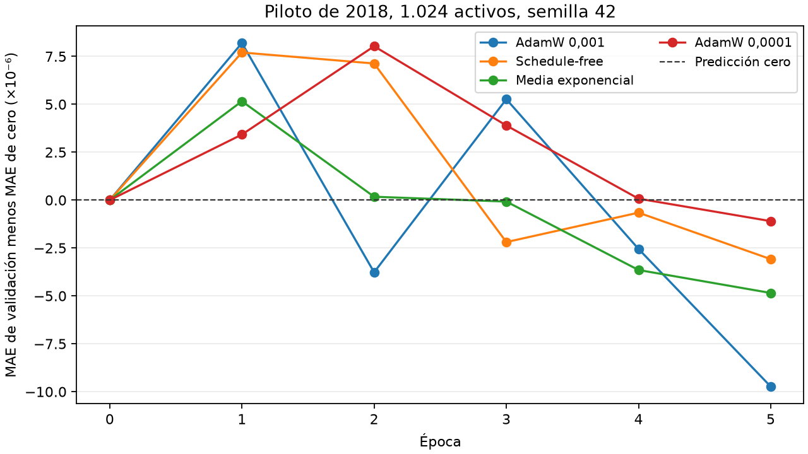

# Aprendizaje y comparación en dos equipos

Revisión del 14 de noviembre de 2026 para [#836](https://github.com/GonxKZ/mars-titan/issues/836). Distingue la configuración vigente, las medidas del piloto y las propuestas que todavía necesitan comprobación. No registra nuevos entrenamientos. La [declaración de la campaña](../../configs/experiments/comparison-campaign-v1.json) fija ocho orígenes, diez épocas de ajuste y cinco de lector antes del lanzamiento.

La prioridad es completar la comparación de los 28 modelos con aprendizaje suficiente y resultados interpretables antes del 5 de diciembre a las 00:00 de Madrid. Ampliar el número de años evaluados ocupa el mismo presupuesto que ajustar mejor cada modelo, comprobar sus curvas o recuperar un fallo. La propuesta de trece años no deja ese margen si se alargan los entrenamientos. El piloto tampoco permite afirmar que ocho épocas agoten el aprendizaje. La duración de la RTX 5060 sigue sin medir.

## Qué demuestra el piloto y qué falta

La [evidencia del piloto](../../reports/engineering/comparison-campaign-20261113/pilot.json) compara cuatro recetas con escala durante cinco épocas sobre el origen 2018 y la semilla 42. AdamW con tasa 0,001 obtuvo su mejor MAE de validación en la quinta época. Su curva no fue monótona: 0,010775810, 0,010763843, 0,010772877, 0,010765060 y 0,010757877. Que el último punto sea el mejor pide comprobar una continuación más larga, pero no demuestra que esa continuación vaya a mejorar.

La reducción del MAE bruto frente a cero en la evaluación del piloto fue del 0,0446 %. No hay todavía intervalos por bloques para esa diferencia ni una repetición completa en las tres semillas. El error de ajuste y el de validación corresponden a periodos distintos, con distinta volatilidad. Su diferencia no permite diagnosticar por sí sola sobreajuste o falta de capacidad. Las pruebas de gradientes, causalidad y recuperación acreditan comportamientos técnicos, no utilidad predictiva.

Cada punto procede de una evaluación guardada del piloto. Los valores negativos mejoran a cero en ese tramo. Las líneas unen los puntos observados y no extrapolan épocas futuras.

La selección del optimizador se hizo sobre Titans-MAC. No es una búsqueda equivalente para GRU, LSTM, RNN, DLinear o Transformer. La [guía de ajuste de Google Research](https://github.com/google-research/tuning_playbook/blob/main/README.md#identifying-scientific-nuisance-and-fixed-hyperparameters) explica que la tasa de aprendizaje puede interactuar con la arquitectura y que fijarla limita las conclusiones. Compartir una receta es un control experimental válido, pero no prueba que se haya encontrado la mejor receta de cada familia.

Se necesitan dos lecturas diferenciadas. La comparación controlada pregunta qué aporta un componente al mantener constantes datos, receta y actualizaciones frente a su control. La comparación entre familias pregunta qué resultado alcanza cada arquitectura con un presupuesto de búsqueda comparable. Mezclar ambas preguntas favorecería a una familia cuyos hiperparámetros ya se hayan ajustado más.

## Qué aportan las fuentes recientes

[Titans: Learning to Memorize at Test Time](https://arxiv.org/abs/2501.00663) estudia atención y memoria neuronal adaptada durante la inferencia. Sus resultados en otras tareas no acreditan una mejora de esta adaptación financiera. La sorpresa asociativa, las actualizaciones de memoria y los gradientes del ajuste exterior son operaciones distintas. Aumentar el número de refinamientos o la capacidad del banco episódico tampoco equivale a aumentar las épocas del predictor.

[The Road Less Scheduled](https://arxiv.org/abs/2405.15682v4) propone optimización sin un calendario ligado al instante final. Es una alternativa pertinente para presupuestos variables. Ya se ensayó en el piloto y no ganó su criterio de validación. Su resultado en otros problemas no justifica reemplazar aquí al ganador. La [implementación original](https://github.com/facebookresearch/schedule_free) exige distinguir los pesos usados para gradientes de los usados en evaluación y guardado, un contrato que debe conservar cualquier comparación.

[Chronos-2](https://arxiv.org/abs/2510.15821) incorpora relaciones multivariantes y covariables en un modelo preentrenado. El [repositorio de TimesFM](https://github.com/google-research/timesfm) presenta TimesFM 3.0 con soporte multivariante. Son referencias actuales que merecen revisión, pero añadirlas a esta campaña exigiría comprobar disponibilidad temporal de su preentrenamiento, equivalencia de entradas, licencia, adaptación al objetivo residual y coste local. No se consideran modelos comprobados del proyecto ni se añaden al total de 28.

[GIFT-Eval](https://arxiv.org/abs/2410.10393) ofrece una evaluación amplia de modelos de series temporales. [FinVerse, versión 3](https://arxiv.org/html/2608.03259v3), informa de una correlación de 0,43 entre sus clasificaciones y las de GIFT-Eval para los modelos analizados. También reconoce limitaciones de costes de negociación y disponibilidad temporal. Su resultado respalda distinguir precisión estadística, ordenación y utilidad financiera. No proporciona una clasificación universal aplicable a MARS-TITAN.

La revisión de [Hewamalage, Ackermann y Bergmeir](https://arxiv.org/html/2203.10716v2) explica por qué una referencia sencilla puede ser óptima cuando el proceso no contiene señal adicional aprovechable. En este proyecto, una red debe compararse con el residual cero sobre las mismas filas. Si no lo supera, el resultado debe conservarse. Más complejidad o una predicción visualmente convincente no sustituyen esa comparación.

## Presupuesto que permita terminar la comparación

La [revisión del presupuesto](../../reports/engineering/comparison-budget-review-20261114/scenarios.json) conserva las fórmulas, los recuentos de ajuste, las aproximaciones de cada lector y las medidas del piloto. El reparto final agrupa los 25 modelos neuronales de cada año y semilla en una misma GPU. Hay 24 bloques, trece en la RTX 4070 y once en la RTX 5060. Ridge, LightGBM y momentum/reversión permanecen en la primera. El total es de 349 y 275 trabajos.

| Años evaluados | Épocas de ajuste / lector | RTX 4070 | Segunda GPU si tarda un 20 % más |
| --- | ---: | ---: | ---: |
| Ocho | 8 / 4 | 288–349 h | 286–348 h |
| Ocho, presupuesto elegido | 10 / 5 | 353–429 h | 352–429 h |
| Ocho | 12 / 6 | 418–509 h | 418–510 h |

Los ocho años son 2019–2023 y 2015–2017. El año 2018 pertenece al piloto y 2024 permanece cerrado. El ajuste de los modelos neuronales y Ridge usa toda la historia utilizable desde 2000 hasta el corte de cada origen. LightGBM mantiene su ventana explícita de doce meses. Más años evaluados implican más ajustes independientes, no adelantar el comienzo del corpus.

Se fija 10/5 para observar más aprendizaje que en la propuesta de 8/4 sin consumir el margen que necesitaría 12/6. La propuesta de trece orígenes con 10/5 requería unas 1.160 horas agregadas en el escenario por etiquetas a la velocidad medida de la RTX 4070. Supera las 1.008 horas disponibles entre dos equipos durante veintiún días completos. No se amplían años a costa de dejar modelos sin terminar.

Las horquillas reflejan dos formas de extrapolar los lectores desde doce meses a toda la historia. No son intervalos de confianza ni máximos garantizados. El factor 1,2 de la segunda GPU es un escenario sin medir. La asignación se eligió entre treinta distribuciones con costes del piloto y recuentos de ajuste, sin errores de evaluación. Cada modelo y sus controles neuronales permanecen juntos en un bloque. La exposición de las semillas a la primera GPU queda en cuatro, cuatro y cinco bloques para 42, 43 y 44.

Los tiempos incluyen las validaciones, emisiones y cinco minutos por índice anual y equipo. Se reserva además un día por equipo para incidencias. En el escenario de mayor coste, ambos deben empezar antes de aproximadamente las 02:40 del 16 de noviembre de Madrid para conservar esa reserva. El diagnóstico de la segunda GPU y su arranque real siguen pendientes. No se incluye una búsqueda nueva por familias ni RL. Las curvas largas se registrarán en la campaña con la receta ya fijada, sin cambiarla después de mirar su evaluación.

[AlgoPerf](https://arxiv.org/html/2306.07179v2) distingue el tiempo hasta una calidad fijada del simple número de pasos y exige hardware comparable para atribuir diferencias de velocidad. Aquí pueden compararse errores predictivos bajo el protocolo común, pero las horas medidas en una RTX 4070 y una RTX 5060 no demostrarán por sí solas que una arquitectura sea más rápida. La igualdad de VRAM tampoco implica igualdad de caudal.

El segundo equipo tiene 15,2 GB de RAM y 8 GB de VRAM según la información disponible. LightGBM permanece en el primero: su piloto alcanzó unos 11,25 GiB residentes. La cola del segundo mantiene un trabajador y el diagnóstico exige 6 GiB de RAM disponibles dentro de WSL. Microsoft permite limitar la memoria de WSL mediante [`.wslconfig`](https://learn.microsoft.com/en-us/windows/wsl/wsl-config). El límite configurado no equivale a memoria disponible. Faltan el diagnóstico real, el espacio libre y el comienzo efectivo de su disponibilidad.

## Un modelo y sus continuaciones permanecen juntos

El reparto se define por dependencias de checkpoints. Un ajuste independiente puede asignarse a cualquiera de los equipos. Un lector que parte de `titans_mac/2019/seed-42` necesita precisamente ese estado completado, con su vista, su semilla y su huella. No puede sustituirlo por otro año o por un modelo de arquitectura parecida.

El [motor de la campaña](../../src/mars_titan/training/comparison_campaign.py) exige que padre y lector tengan la misma cola, ordena primero el padre y bloquea al lector mientras no haya terminado. El [ejecutor del lector](../../src/mars_titan/training/mars_titan_walk_forward.py) comprueba la vista, la semilla y el checkpoint seleccionado. Las variantes de redes de esta declaración se ajustan desde cero. Comparten equipo con sus controles del mismo año y semilla, aunque no consuman sus pesos.

Los checkpoints elegidos y los de recuperación tienen funciones distintas. Reanudar un ajuste exige también el estado coherente del optimizador, los generadores y el cursor, además de las memorias que utilice el modelo. La [documentación de PyTorch](https://docs.pytorch.org/tutorials/beginner/saving_loading_models.html#saving-loading-a-general-checkpoint-for-inference-and-or-resuming-training) diferencia el guardado del modelo del necesario para reanudar entrenamiento. El proyecto añade sus identidades temporales y de datos.

Un futuro posentrenamiento o RL que modifique ese mismo modelo debe permanecer en su equipo, salvo una transferencia explícita del conjunto necesario y una comprobación de recuperación. El paquete actual de datos no lleva modelos entrenados. Una política financiera independiente que consuma predicciones tiene otro contrato: necesita las predicciones y su procedencia, no implica continuar automáticamente los pesos del predictor. Ninguna de esas dos rutas está incluida en el presupuesto de esta campaña.

## Comparación controlada y selección competitiva

La búsqueda por familias debe declarar antes de ejecutarse su espacio, número de intentos, máximo por intento, criterio y regla de desempate. Se conservará el resultado de todos los intentos, también los fallidos. El tramo que elige hiperparámetros no puede convertirse después en evidencia independiente de superioridad. Las tres semillas de la comparación deben seguir el mismo procedimiento, sin elegir la más favorable.

Las ablaciones de un componente conservarán su control emparejado, sus filas y sus actualizaciones. Si se usa una parada conjunta, se fijará una regla compartida antes de ejecutar. Una parada independiente que asigne más trabajo a la propuesta debe informarse como otra comparación. El coste de MARS-TITAN debe incluir su padre y el ajuste del lector, además de mostrar por separado el coste incremental del lector.

La evidencia de [Bouthillier et al.](https://arxiv.org/abs/2103.03098) identifica variabilidad debida a muestreo, inicialización e hiperparámetros. Tres semillas no garantizan una clasificación estable. En esta campaña, los contrastes deben conservar el emparejamiento temporal y los intervalos por bloques ya declarados, con corrección por las familias de comparaciones. No se tratarán millones de filas correlacionadas como millones de experimentos independientes.

El análisis final debe exigir las mismas filas, todos los orígenes requeridos, las tres semillas y la identidad prevista del código, los datos y la receta. La tabla parcial de `results` es seguimiento, no ese análisis. Los trabajos incompletos no deben desaparecer de una media ni convertirse en resultados completos. El analizador de los ZIP aplica esas comprobaciones, reconstruye las métricas y las gráficas sin dataset ni pesos y rechaza un análisis completo si falta algún trabajo. Su opción parcial conserva los faltantes y desactiva la inferencia comparativa.

El MAE residual por sesión sigue siendo el criterio principal declarado. La correlación de Pearson, la de Spearman y el MAE tras calibrar responden a preguntas distintas y deben conservar sus nombres. LightGBM y la regla de momentum predicen un orden, por lo que su MAE bruto no se equipara al de un predictor de magnitud. La calibración usa exclusivamente su tramo anterior a la evaluación. Para hablar de utilidad financiera hace falta además el contrato de decisión y sus costes, que no se deduce de una pequeña reducción del MAE.

2023 ya fue utilizado en estudios previos y no puede presentarse como test virgen. Los años anteriores a 2018, evaluados con una receta elegida usando 2018, constituyen análisis histórico retrospectivo. Estas limitaciones deben aparecer junto al resultado, aunque todas las comprobaciones técnicas pasen. El test final de 2024 permanece cerrado durante la selección.

## Alcance de las conclusiones

El presupuesto de 10/5 no fue validado por un segundo piloto. La campaña conserva todas las evaluaciones de validación y selecciona su mejor estado según la regla declarada. Puede revelar mejoras tardías, deterioro o aprendizaje insuficiente. Ese resultado no se corregirá ocultando intentos ni escogiendo otra receta con el año evaluado.

Esta campaña es una comparación controlada. No acredita que cada familia haya recibido su búsqueda competitiva óptima. Una búsqueda por familias con presupuesto equivalente sigue siendo un estudio distinto, con su propio coste y tramos de selección. Los 64 estados ocultos, la capa única y el banco de 1.024 episodios tampoco se presentan como capacidades óptimas. GRU, LSTM, RNN y DLinear sustituyen el codificador de precios dentro del predictor común, como declara el diseño. No equivalen a todas las implementaciones posibles de esas arquitecturas.

La preparación de datos debe seguir conservando máscaras, disponibilidad temporal y ajustes calculados solo sobre el pasado. Un dato ausente no se sustituye por un precio o una noticia inventados. Las comprobaciones de valores finitos, gradientes, causalidad y recuperación siguen siendo necesarias, pero no prueban que haya señal predictiva aprovechable.

Las optimizaciones de ejecución se adoptarán con coste total, paridad y memoria medidos. El cambio de precisión, una biblioteca nueva o más trabajadores no se considerarán mejoras por su nombre. El perfil anterior del lector y los fallos reales de memoria ya muestran que usar más recursos puede empeorar o impedir una ejecución.

Quedan sin medir el rendimiento del segundo equipo y las curvas completas de la campaña. El ZIP conserva predicciones y objetivos, historiales, fallos y costes registrados, pero no permite evaluar un checkpoint no emitido ni calcular una política financiera sin sus entradas y contrato. Los valores ausentes permanecen identificados como no medidos. Ninguna comprobación técnica garantiza ausencia de error predictivo o terminación ante fallos del equipo.
