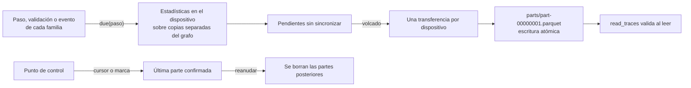

# Trazas de aprendizaje

La comparación de la campaña mide el resultado final de cada modelo. Estas trazas sirven para entender qué ha aprendido y por qué una pieza ayuda o no: si las puertas de la memoria de Titans se saturan, si el olvido borra todo en pocas sesiones, si los gradientes de un grupo de parámetros se apagan o si un adaptador apenas se mueve del padre. Se siguen en [#448](https://github.com/GonxKZ/mars-titan/issues/448), sobre el registrador de [#467](https://github.com/GonxKZ/mars-titan/pull/467).

Las trazas solo observan. No entran en la identidad de ninguna ejecución, no consumen números aleatorios y no deciden nada: ni la selección, ni la parada, ni la evaluación. Las pruebas exigen los mismos bits con trazas y sin ellas.

## Contrato

Cada ejecución escribe una carpeta `traces/` con `manifest.json` y partes Parquet numeradas. El manifiesto declara:

| Campo | Contenido |
| --- | --- |
| `schema_version`, `kind` | `1` y `learning_traces` |
| `identity` | `family` y `run_identity_sha256`, la huella de la identidad de la ejecución |
| `config` | `every`, `max_bytes` y `enabled`, los campos de `TraceConfig` |
| `step_unit` | Unidad del paso: `optimizer_step`, `write_event`, `boosting_round`, `fit`, `transition` o `wave` |
| `stats`, `columns` | Las siete estadísticas y las seis columnas del esquema |
| `exhausted_at_step` | Primer paso que no cupo en el presupuesto, o `null` |

Las columnas son `step` (int64), `phase`, `metric`, `group`, `stat` (texto) y `value` (float64). El formato largo permite añadir métricas sin cambiar el esquema. `read_traces` lo comprueba todo al leer: versión y tipo, configuración, columnas y estadísticas declaradas, unidad del paso, numeración sin huecos, esquema de cada parte, suma de tamaños dentro de `max_bytes`, pasos no negativos y nombres con la forma `[a-z][a-z0-9_.:/-]{0,95}`.

**Cadencia.** `due(step)` solo compara enteros, así que decidir si toca registrar no sincroniza la GPU. La declaración de ejecución fija `every` en pasos del optimizador y `every_by_unit` para las demás unidades, por ejemplo transiciones u oleadas de la etapa RL. `hooks.unit_config` elige la cadencia de cada unidad.

**Estadísticas.** Para cada tensor se calculan, en float64 y sobre los valores finitos, media, desviación típica, mínimo, máximo, máximo absoluto, norma L2 y fracción de valores finitos. Sin valores finitos, todas valen NaN salvo la fracción, de modo que una divergencia queda registrada como tal. Los escalares se guardan con la estadística `value`.

**Presupuesto.** Si una parte haría superar `max_bytes`, no se escribe. Las trazas quedan agotadas y el manifiesto guarda el primer paso perdido. No hay recortes silenciosos. La campaña suma a su proyección de disco el presupuesto de cada ajuste o control en línea pendiente (`masked_campaign._with_traces`), porque la retención no borra trazas.

**Recuperación en Python.** El punto de control guarda el cursor (`sequence`, `bytes`, `exhausted_at`). Al reanudar se borran las partes posteriores y se comprueba que las confirmadas siguen ahí con el mismo tamaño. Lo que los observadores acumulaban desde el último paso se descarta al guardar, de modo que un recorrido reanudado registra lo mismo que uno sin cortes.

**Recuperación en la etapa RL nativa.** Los binarios escriben el mismo contrato desde C++ (`native/src/learning_traces.cpp`) y añaden al manifiesto una sección `native` con la marca de confirmación de cada parte. PPO y Double DQN marcan con (transiciones, evaluaciones), los dos contadores que guarda cada checkpoint. KLPO marca la actualización de la oleada w con (w, 0) y su validación con (w, 1). Al reanudar se calcula la marca del estado recuperado y se borran las partes con una marca mayor y los restos que no llegaron al manifiesto. En KLPO, la parte de la actualización se escribe antes del paso de Adam y la confirma la publicación de los contadores, así que un corte entre los dos no pierde ni duplica la oleada.

## Ganchos por familia

`hooks.TrainingTraces` es el contrato común de los entrenadores: `update(paso, optimizador, pérdida)` envuelve el recorte y el paso del optimizador, `observing(paso)` activa los observadores durante el forward del paso, `validation(evento)` registra cada validación completa y vuelca, y `checkpoint()` y `restore(cursor)` acompañan al estado guardado.

| Familia (`identity.family`) | Unidad | Entrenador | Qué se registra |
| --- | --- | --- | --- |
| `neural_reference` | `optimizer_step` | `reference_run` | Pérdida, gradientes, pesos y razón de actualización por grupo, norma total y tasa de aprendizaje |
| `transformer_compact_online` | `optimizer_step` | `online_reference` | Lo mismo, con fases `online_<tramo>` y `validation` |
| `titans_mac`, `cm_v1_core` | `optimizer_step` | `ChronologicalTrainer` | Lo común y el observador de la memoria neuronal |
| `mars_titan_*_readout`, `cm_v1_readout` | `optimizer_step` | `ReadoutTrainer` | Lo común sobre los parámetros del lector |
| `episodic_gru` | `optimizer_step` | `CandidateChronologicalTrainer` | Lo común sobre la GRU candidata |
| `posttraining`, `posttraining_titans_mac`, `posttraining_readout`, `posttraining_episodic_gru` | `optimizer_step` | `run_case` y los entrenadores cronológicos | Lo común y el observador de adaptadores |
| `b6` | `write_event` | `CorrectionInference` | Escrituras, norma de A y estadísticas del error escrito, con fase `b6_<tramo>` |
| `ridge` | `fit` | `run_tabular_reference` | Un evento: puntuación de validación, coeficientes y término independiente |
| `xgboost` | `boosting_round` | `run_external_reference` | Puntuación, mejor puntuación y rondas sin mejora |
| `ppo_*_v1`, `double_dqn` | `transition` | `mars-titan-ppo` | Pérdidas de política y crítico, entropía, KL, recorte, norma del gradiente y validaciones |
| `klpo_terminal` y objetivos de grupo | `wave` | `mars-titan-klpo` | Sustituto, norma del gradiente, episodios, decisiones y validaciones |

Los grupos de parámetros siguen una regla común, la clave del módulo y el primer componente del nombre (`predictor.memory`, `readout.bank`), así que no hay que declararlos por familia. La razón de actualización de un grupo es

$$
r_t = \frac{\lVert W_t - W_{t-1} \rVert_2}{\lVert W_{t-1} \rVert_2},
$$

y `UpdateProbe` solo copia los pesos anteriores en los pasos que tocan registro.

**Memoria de Titans.** `MemoryObserver` se engancha a cada `NeuralMemory`. Durante el forward de un paso registrado acumula en el dispositivo las puertas de olvido (α), momentum (η) y tasa interna (θ), la pérdida asociativa y las normas de los pesos rápidos y del momentum por capa. Al registrar da su media, desviación típica, mínimo y máximo, y en las puertas las fracciones por debajo de 0,01 y por encima de 0,99, un umbral fijado antes de ejecutar.

**Adaptadores.** `AdapterObserver` registra en cada validación, por tensor adaptado, la norma de ΔW = W' − W, su norma relativa, su máximo absoluto y sus ocho mayores valores singulares, y la norma de los adaptadores por módulo. Usa `update_statistics`, descrita en la [variedad de adaptadores](../engineering/adapter-variety.md#trazas-para-448).

**Etapa RL.** Las filas de actualización se registran cuando el avance cruza un múltiplo de la cadencia, y las de validación siempre. Sus métricas usan los prefijos `policy.`, `critic.` y `rl.`. La validación de las políticas no se llama `validation.score`, porque su criterio (el crecimiento logarítmico) se maximiza. La orden de la etapa (`simulation.campaign_stage run --execution`) exige que los binarios declaren la capacidad `native_policy_learning_traces` antes de abrir fuentes.

**Postentrenamiento y etapas.** `posttraining.campaign_stage run --execution` y `simulation.campaign_stage run --execution` toman las trazas de la misma declaración que la campaña, y `rolling_retention` las pasa a la base, al postentrenamiento y a la RL.

## Garantía de no interferencia

Cada familia tiene una prueba que recorre el mismo ajuste con trazas en cada paso y sin trazas y exige los mismos recibos, predicciones y estados, sin pasos de optimizador: los optimizadores de las pruebas solo cuentan llamadas. Las pruebas de reanudación cortan el ajuste y exigen que el recorrido reanudado tenga las mismas filas que uno sin cortes, sin claves repetidas.

| Familia | Prueba en CPU |
| --- | --- |
| Referencias neuronales | `tests/training/test_masked_reference_run.py` |
| Control en línea | `tests/training/test_online_reference.py` |
| Titans-MAC y núcleos de CM-v1 (comparten `run_titans_window`) | `tests/training/test_titans_walk_forward.py` |
| Lectores de MARS-TITAN y de CM-v1 (comparten `run_readout_window`) | `tests/training/test_mars_titan_walk_forward.py` |
| GRU candidata | `tests/training/test_candidate_walk_forward.py` |
| B6 | `tests/training/test_mars_titan_correction.py` |
| Postentrenamiento | `tests/posttraining/test_candidate_adapters.py`, `test_readout_windows.py` y `test_adapter_campaign_stage.py` |
| Ridge y XGBoost | `tests/learning_traces/test_campaign_traces.py` |
| PPO, Double DQN y KLPO | `tests/learning_traces/test_native_policy_traces.py` y `native/tests/learning_traces_tests.cpp` |
| Medida del coste | `tests/learning_traces/test_overhead.py` |

En `cuda:0`, `tests/learning_traces/test_traces_cuda.py` repite la paridad bit a bit de las cinco referencias neuronales, de la memoria neuronal con su observador y del bloque MAC completo en varios segmentos, con TF32 desactivado. Ridge y XGBoost no se ajustan en las pruebas: se comprueban sus eventos con un modelo y un estado fijados. Los binarios RL solo pueden recorrer validaciones sin pasos de optimizador, así que las filas de actualización se comprueban en la prueba nativa del escritor y el resto quedará a la vista en la primera ejecución real. Las tres pruebas que lanzan un ajuste nativo necesitan la protección abierta, así que figuran en el inventario de #546 y se omiten mientras rige el bloqueo.

## Coste

`python -m mars_titan.learning_traces.overhead` mide el coste en `cuda:0` sin pasos de optimizador. Recorre cada familia en tres condiciones alternadas en cada repetición (sin trazas, con registro en cada paso y con la cadencia declarada) y guarda, por familia, el tiempo por fila, el coste relativo frente a la condición sin trazas, el pico de VRAM, el tiempo de cada validación y los bytes escritos. Las referencias neuronales y los casos de la matriz de adaptadores recorren lotes reales de ajuste. Titans-MAC, la GRU candidata, los lectores de MARS-TITAN, CM-v1 y B6 recorren su ajuste o su inferencia cronológica con `campaign_throughput`. De Ridge y XGBoost se mide el evento con la anchura real de la vista. `tests/learning_traces/test_overhead.py` recorre la orden en CPU sobre el corpus técnico.

La medida con las formas de la campaña todavía no se ha ejecutado. La vista US+CN/fold-012 de la edición v3, la única que quedaba en disco, ya no se puede leer porque la sustitución de la v3.1 retiró las muestras de 1.551 activos de Estados Unidos. La medida se hará con las vistas de la v3.1, junto con las demás medidas previas al entrenamiento y con la máquina libre. Hasta entonces la declaración de ejecución no declara trazas, así que la campaña no las escribe. La cadencia y el presupuesto se fijarán con esa medida y con el número de trabajos de cada etapa, porque `masked_campaign._with_traces` suma a la proyección de disco el presupuesto de cada trabajo pendiente.

## Análisis

`scripts/analyze_learning_traces.py` lee una o varias carpetas (`--traces`) o todas las de una salida (`--root`) y escribe un informe JSON y otro Markdown con reglas fijas declaradas en `learning_traces/analysis.py`:

- Validación: puntuación por paso, mejor paso y última puntuación de `validation.score` (menor es mejor).
- Optimización: pérdida al principio y al final, fracción de pasos con la norma por encima del umbral de recorte y, por grupo, la mediana de la norma del gradiente y de la razón de actualización. Un grupo con razón siempre nula no se ha movido.
- Memoria de Titans: puertas al final, fracciones saturadas y pérdida asociativa al principio y al final.
- Adaptadores, B6 y políticas: el último valor de sus métricas.
- Integridad: valores no finitos y estadísticas de tensores con valores no finitos.

`align` reúne una métrica de varias ejecuciones sobre la unión de sus pasos, sin interpolar. Las reglas describen lo registrado y no sustituyen a la evaluación. El [informe de prueba](../../reports/engineering/learning-traces-fixture-analysis-20261013.md) se genera con trazas de las pruebas de cada familia y no tiene ningún significado científico. Reúne 26 ejecuciones de 15 familias. Los núcleos y lectores de CM-v1 (`cm_v1_core`, `cm_v1_readout`) comparten entrenador con Titans-MAC y con los lectores y no tienen una ejecución propia en él.

## Observatorio

`scripts/export_learning_traces.py --root SALIDA --output PAQUETES --watch 30` convierte en paquetes del observatorio las carpetas de trazas que cambian, con la unidad del eje del manifiesto, y `serve_observatory.py --traces-dir PAQUETES` los sirve. Ver [el observatorio](../engineering/observatory.md).

## Límites

- El banco episódico de los lectores y de la GRU candidata solo se ve a través de sus parámetros. Sus admisiones y recuperaciones no se trazan todavía.
- El observador de la memoria sigue la escritura por flujo de `NeuralMemory.update`. La escritura compartida de la memoria de mercado PT4 (`update_shared`) todavía no le llama.
- La masa de atención sobre los tokens persistentes, la lectura de la memoria y el contexto no se registra.
- La deriva de representaciones con CKA y las regresiones lineales de diagnóstico sobre el estado de memoria quedan fuera de esta entrega.
- Ridge y XGBoost no tienen paridad con trazas medida sobre un ajuste real, porque las pruebas no ajustan. Sus eventos solo leen el modelo ya resuelto o el estado de selección.
- El coste con las formas de la campaña está pendiente de las vistas de la v3.1 (ver [Coste](#coste)).
