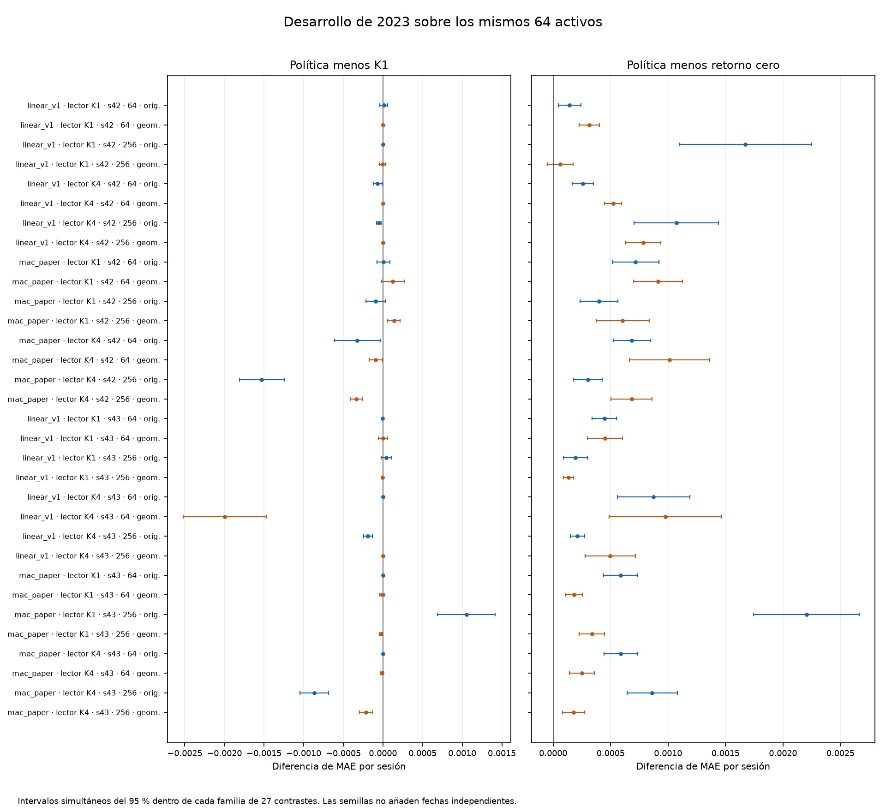

# Resultado provisional del estudio de refinamientos

Ninguno de los 32 selectores de rutas completos tiene menor MAE observado que el
predictor de retorno residual cero. Esto ocurre tanto en las poblaciones
completas de cada cohorte como al puntuar los mismos 64 activos comunes. Hay
reducciones de error frente a K1 en algunos casos, pero no respaldan una mejora
general del predictor frente al control cero.

El corte comprende las semillas 42 y 43, las proyecciones `linear_v1` y
`mac_paper`, lectores entrenados con K1 y K4, cohortes de 64 y 256 y las dos
representaciones gráficas. Son ocho grupos completos de comparación y cuatro
pendientes de la semilla 44. Las 32 combinaciones no son 32 réplicas temporales
independientes. La evaluación usa 249 sesiones de 2023, que ya se había utilizado
como desarrollo. El test final sigue cerrado.

En las poblaciones completas, el selector reduce el MAE respecto a K1 en 18
casos, lo aumenta en siete y tiene idéntico MAE en siete. Sobre los 64 activos
comunes, los recuentos de menor, mayor e idéntico MAE
son 19, seis y siete. Estas son comparaciones puntuales. Los intervalos se
conservan para distinguir diferencias respaldadas dentro de cada familia de
resultados inconcluyentes.

La tabla muestra la proyección `linear_v1` y el lector entrenado con K1. Todos
los valores se calculan sobre las mismas 15.936 filas de los 64 activos comunes.
El MAE del control cero es 0,01584945 en esas filas. La cohorte indica el conjunto
de ajuste y contexto episódico, no un cambio de las filas puntuadas.

| Semilla | Cohorte | Gráficos | MAE K1 | MAE del selector |
| --- | ---: | --- | ---: | ---: |
| 42 | 64 | Originales | 0,01598252 | 0,01599233 |
| 42 | 64 | Geometría | 0,01616383 | 0,01616265 |
| 42 | 256 | Originales | 0,01752209 | 0,01752209 |
| 42 | 256 | Geometría | 0,01591446 | 0,01591139 |
| 43 | 64 | Originales | 0,01629775 | 0,01629558 |
| 43 | 64 | Geometría | 0,01629993 | 0,01629959 |
| 43 | 256 | Originales | 0,01599789 | 0,01604194 |
| 43 | 256 | Geometría | 0,01598947 | 0,01598429 |

La diferencia entre las representaciones original y geométrica cambia entre
semillas y proyecciones. No basta para afirmar una mejora general ni para superar el
control cero en este corte. Ampliar la cohorte también cambia la composición del
banco episódico, por lo que el contraste no aísla solo la cantidad de datos de
ajuste.

Un delta negativo indica menor error del selector. Los intervalos del 95 % usan
2.000 réplicas de bootstrap circular, bloques de 16 fechas UTC observadas y
sensibilidad con 8 y 32. Todos los activos de una fecha se remuestrean juntos.
Hay corrección simultánea dentro de cada familia, de 27 contrastes sobre los
64 comunes y nueve sobre cada población completa. No hay una corrección global
entre todas las semillas, proyecciones y lectores.

`utc_day_index` es la posición en la lista de fechas observadas. Un viernes y el
lunes siguiente pueden tener índices consecutivos. Se corrigió una descripción
que lo confundía con una distancia en días naturales. La repetición del análisis
con la descripción corregida produjo exactamente los mismos resultados
numéricos y tablas por sesión. La regresión con un fin de semana pasó, junto con
otros 27 casos, y detectó una mutación que restauraba la descripción incorrecta.

El [resumen legible por máquina](summary.json) conserva los 32 casos. Los
[resultados completos del corte](interim-v1/results.json) incluyen los
contrastes, intervalos, sensibilidad y referencias a tablas por sesión. Los
[controles originales](controls.json) conservan rutas fijas, umbral, selección
por hash, K4 con consulta por paso, núcleo, M0, contracción escalar y cero, con
sus métricas e intervalos. Las predicciones por muestra y los checkpoints
permanecen en el almacén de ejecuciones y se identifican mediante sus huellas.

La supervisión inicial cerró 210 de 288 tareas y detuvo otra al agotar las ocho
horas acumuladas de la cohorte de 256. Se registró una continuación de las mismas
78 tareas, con límites acumulados de 18 horas conjuntas, 12 por cohorte y seis
por representación. Los 211 intentos anteriores siguen contabilizados. No se
modifican épocas, semillas, candidatos ni criterios de selección.

El primer reinicio completó otra tarea y detectó que la reserva interna del
intento interrumpido seguía abierta. Se confirmó su coste con los 222,201
segundos observados por el supervisor externo, usados como cota conservadora,
conservando ambos recibos originales. El intento no se marcó como completado.
El saldo externo no cambió. La supervisión revisada comprueba también esas
reservas internas. Pasó 17 pruebas CPU y 12 mutaciones dirigidas, incluida la
reversión de los dos recibos si falla una escritura. Las huellas, límites y
comprobaciones están en [continuation.json](continuation.json).

El código científico está fijado en `6b037a7262d4c2d97105b194a137f8b2f5767b01`.
El análisis corregido usa `3235bed9a7c8cdb198ab9036cf76f0df0afc8278`.
Las [medidas de latencia](../../engineering/refinement-selected-latency-20261019/README.md)
son una comprobación independiente sobre modelos congelados. La tercera semilla
y la comparación multisemilla completa siguen pendientes.
