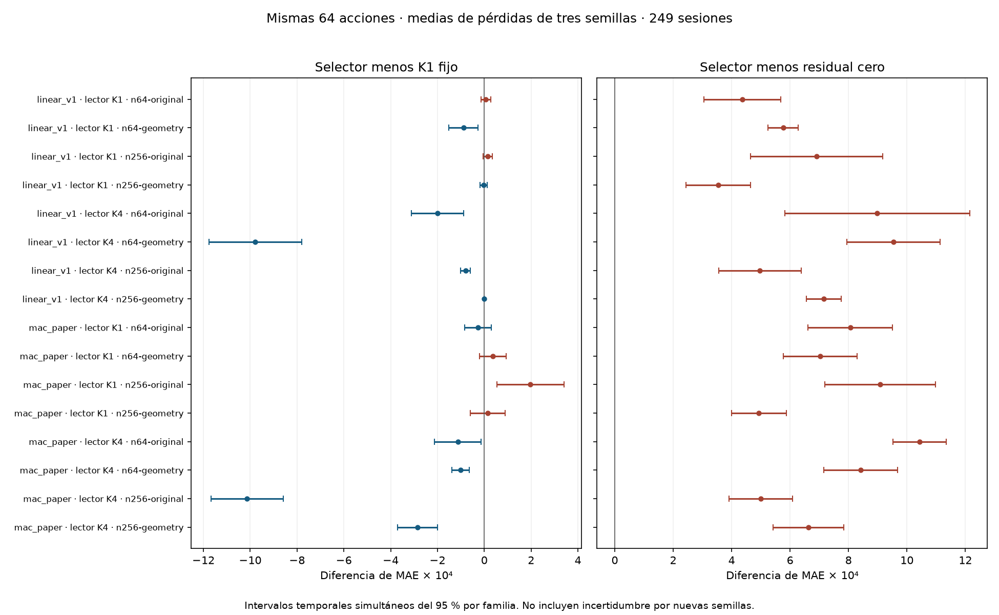

# Resultado completo de la ronda de refinamientos

La ronda terminó el 19 de octubre de 2026 a las 18:29:05 UTC con las 288 tareas
previstas completas. Ninguno de los 48 selectores tiene menor MAE observado que
el predictor de retorno residual cero. Las 16 medias de tres semillas tampoco
lo superan. El resultado no respalda promocionar el selector como mejora
general de MARS-TITAN.

Se completaron las semillas 42, 43 y 44, las proyecciones `linear_v1` y
`mac_paper`, los lectores ajustados con K1 y K4, las cohortes de 64 y 256 activos
y las representaciones gráficas original y geométrica. El contraste de escalado
conserva las mismas 64 acciones y sus 15.936 filas puntuadas en 249 sesiones
de 2023. Las poblaciones completas de 256 tienen 63.679 filas y se presentan
aparte. El año 2023 es desarrollo reutilizado. El test final de 2024 y la
campaña completa siguen cerrados.

## Error y variabilidad

En los 64 activos comunes, el control cero tiene MAE 0,01584945. Las medias de
los selectores están entre 0,01620390 y 0,01689302, un error entre el 2,24 % y
el 6,58 % mayor. Cada media promedia pérdidas por sesión de las tres semillas,
no predicciones de un ensemble. La desviación entre semillas se informa aparte
de la incertidumbre temporal.

La tabla usa siempre las mismas filas de los 64 activos comunes. La cohorte
indica el tamaño usado para ajuste y contexto episódico. K1 o K4 identifica
cómo se ajustaron los pesos del lector. El selector decide después entre
las seis rutas disponibles. Delta es MAE del selector menos MAE del control.

| Proyección | Lector | Cohorte | Gráficos | MAE del selector | Desv. entre semillas | Delta frente a K1 | Delta frente a K4cc |
| --- | --- | ---: | --- | ---: | ---: | ---: | ---: |
| `linear_v1` | K1 | 64 | Originales | 0,01628576 | 0,00028865 | +0,00000632 | -0,00759198 |
| `linear_v1` | K1 | 64 | Geometría | 0,01642605 | 0,00034450 | -0,00008912 | -0,00810402 |
| `linear_v1` | K1 | 256 | Originales | 0,01654044 | 0,00085017 | +0,00001468 | -0,00168782 |
| `linear_v1` | K1 | 256 | Geometría | 0,01620390 | 0,00044500 | -0,00000275 | -0,00364296 |
| `linear_v1` | K4 | 64 | Originales | 0,01674774 | 0,00065309 | -0,00020074 | +0,00026008 |
| `linear_v1` | K4 | 64 | Geometría | 0,01680416 | 0,00042315 | -0,00097800 | +0,00030261 |
| `linear_v1` | K4 | 256 | Originales | 0,01634621 | 0,00049761 | -0,00008015 | +0,00018972 |
| `linear_v1` | K4 | 256 | Geometría | 0,01656460 | 0,00019406 | 0,00000000 | 0,00000000 |
| `mac_paper` | K1 | 64 | Originales | 0,01665575 | 0,00027627 | -0,00002666 | -0,01900235 |
| `mac_paper` | K1 | 64 | Geometría | 0,01655238 | 0,00045388 | +0,00003713 | -0,00507033 |
| `mac_paper` | K1 | 256 | Originales | 0,01675823 | 0,00113038 | +0,00019689 | -0,00871722 |
| `mac_paper` | K1 | 256 | Geometría | 0,01634286 | 0,00013959 | +0,00001485 | -0,00187562 |
| `mac_paper` | K4 | 64 | Originales | 0,01689302 | 0,00070771 | -0,00011296 | +0,00032797 |
| `mac_paper` | K4 | 64 | Geometría | 0,01669092 | 0,00052697 | -0,00010174 | +0,00031332 |
| `mac_paper` | K4 | 256 | Originales | 0,01634914 | 0,00031449 | -0,00101304 | -0,00015834 |
| `mac_paper` | K4 | 256 | Geometría | 0,01651153 | 0,00047444 | -0,00028597 | +0,00019231 |

Los intervalos del 95 % usan bootstrap circular con 2.000 réplicas, semilla
20261018 y bloques de 16 fechas UTC observadas, con sensibilidad fijada en
8 y 32. Todos los activos de una fecha permanecen juntos. La corrección
simultánea cubre 27 contrastes en cada familia de los 64 comunes y nueve en
cada población completa. No cubre conjuntamente todas las proyecciones,
lectores y semillas. Los intervalos de las medias describen incertidumbre
temporal condicionada a estas tres semillas, no incertidumbre frente a nuevas
inicializaciones. Las tres semillas no convierten 249 sesiones en 747 fechas
independientes.

Frente a K1, las 48 comparaciones individuales sobre los 64 comunes tienen
30 deltas negativos, siete positivos y once nulos. Al promediar semillas,
diez deltas son negativos, cinco positivos y uno nulo. Ocho medias tienen su
intervalo simultáneo completo por debajo de cero frente a K1 y una por encima.
Las 16 medias tienen su intervalo completo por encima de cero frente al
predictor residual cero, dentro de sus respectivas familias.

K4cc aplicado a lectores ajustados con K1 presenta errores elevados en varias
combinaciones. Ese control mide un cambio del número de refinamientos en
inferencia, no un lector ajustado con K4. La ventaja frente a ese control no
basta para justificar el selector. Entre las ocho medias con lectores ajustados
con K4, el selector obtiene mayor MAE que K4cc en seis, menor en una y el mismo
en otra. Los controles con pesos ajustados para K4 permanecen en la comparación.

La geometría tampoco ofrece una ventaja uniforme. Con 256 activos y lectores
K1, su delta frente a gráficos originales es -0,00033654 con `linear_v1` y
-0,00041537 con `mac_paper`. Sus intervalos simultáneos respectivos son
[-0,00051028, -0,00016281] y [-0,00054767, -0,00028308]. Con lectores K4, los
deltas pasan a +0,00021840 y +0,00016240, con intervalos [0,00008293, 0,00035387]
y [0,00007170, 0,00025309]. Estos resultados corresponden a las mismas 64
acciones. La interacción entre tamaño y representación cambia según el lector
y la proyección. No se deduce una mejora universal al combinar factores.

## Controles e interpretación

Los 14 controles y salidas de cada caso están en [controls.json](controls.json).
Incluyen rutas fijas, umbral, asignación por hash, K4 con consulta por paso,
núcleo sin lector, M0, contracción escalar y residual cero. Se conservan MAE,
MSE, RMSE, dirección, correlación de rangos y calibración cuando sus salidas
lo permiten, junto con los contrastes por bloques de 8, 16 y 32 fechas.

Sobre las poblaciones completas y por semilla, el selector tiene menor MAE que
M0 en 17 casos, mayor en 28 e idéntico en tres. Frente al umbral sencillo, los
recuentos son 30 menores y 18 mayores. Frente al control por hash son 31 menores,
seis mayores y once iguales. Son recuentos descriptivos de configuraciones
dependientes, no observaciones independientes ni probabilidades de éxito.

Los 48 controles de contracción escalar eligieron coeficiente cero usando
validación. Por eso coinciden con el predictor residual cero en esta ronda.
El selector no supera a ninguno de ellos. Once de los 48 lectores episódicos
conservaron el checkpoint inicial por selección de validación. Las 96 tareas
de ajuste, contando 24 núcleos, 24 lectores M0 y 48 lectores episódicos,
ejecutaron 1.308 actualizaciones cada una. Seleccionar el estado inicial no
significa que no se hayan ejecutado las dos épocas ni consumido su presupuesto.

La política queda como componente experimental desactivado por defecto. El
resultado permite estudiar cuándo refinar evita parte del error de un control,
pero no acredita una mejora frente a los controles fuertes ni justifica una
nueva identidad de baseline. Cualquier revisión predictiva posterior necesita
su propio protocolo. No se añaden candidatos a esta ronda después de leer 2023.

## Coste y trazabilidad

Se registraron 289 intentos para 288 tareas. El intento interrumpido por cuota
se repitió y terminó. El cierre verifica los recibos externos, sus hashes y las
reservas internas, sin reservas abiertas. El tiempo externo acumulado fue
57.855,338 segundos (16,071 horas), dentro de la ampliación declarada de
18 horas. No cabía en la cuota original de 16 horas. Los modelos, semillas,
épocas y criterios de selección conservaron el protocolo original.

| Cohorte | Gráficos | Tiempo de intentos (h) | Pico RSS (GiB) | CUDA asignada pico (MiB) | CUDA reservada pico (MiB) |
| ---: | --- | ---: | ---: | ---: | ---: |
| 64 | Originales | 2,533 | 2,089 | 196,770 | 222,000 |
| 64 | Geometría | 2,503 | 2,070 | 196,770 | 222,000 |
| 256 | Originales | 5,576 | 2,769 | 603,812 | 642,000 |
| 256 | Geometría | 5,460 | 2,776 | 603,812 | 642,000 |

Los ajustes de los núcleos consumieron 6.378,243 segundos, los lectores M0
5.551,362 y los lectores episódicos 18.329,121. La colección de trazas ocupó
1.431,704 segundos. La selección consumió 11.942,853 segundos, incluido el
intento interrumpido. Las referencias del núcleo y M0 ocuparon 1.675,304
segundos y la evaluación con sus controles 12.546,752.

La selección completó 576 candidatos ridge y 432 candidatos por umbral.
Sus validaciones registraron 5.964,143 y 4.437,422 segundos, respectivamente.
De ellos, 5.457,518 y 3.948,413 corresponden a candidatos no elegidos.
Estos tiempos de fase están incluidos en el coste de selección, no se suman
otra vez. La colección compartió los prefijos de las seis rutas y ejecutó
nueve refinamientos por predicción. En despliegue solo se ejecutó la ruta
elegida. Once políticas eligieron K1 en todas sus predicciones de evaluación.

El caudal de fase se calcula como filas puntuadas dividido por el tiempo que
incluye calentamiento, preparación, emisión o colección y maduración. La tabla
resume las medianas de 24 casos por tamaño, no una nueva medida sincronizada de
latencia ni la velocidad de un único modelo representativo.

| Recorrido | 64 activos (filas/s) | 256 activos (filas/s) |
| --- | ---: | ---: |
| Colección del ajuste | 665,970 | 1.127,024 |
| Colección de validación | 1.226,206 | 1.980,344 |
| Selector en evaluación | 1.930,024 | 3.143,227 |
| K1 en evaluación | 2.100,339 | 3.217,579 |
| K4cc en evaluación | 1.988,719 | 3.165,080 |

[phase-costs.json](phase-costs.json) conserva los tiempos de cada candidato,
los rangos de caudal y los contadores de cada fase. No se seleccionó un modelo
por estos tiempos ni se deduce de ellos una reducción causal de latencia.

El tiempo suma los intentos del supervisor, con cálculo, preparación y E/S.
No es tiempo de kernels GPU. Excluye las pausas entre continuaciones, el
análisis estadístico y las comprobaciones técnicas de latencia. Los picos son
máximos de los recibos por proceso, no sumas entre procesos. CUDA corresponde
al asignador de PyTorch y no a toda la memoria del dispositivo. No se midió
energía. El equipo fue una RTX 4070 Laptop de 8 GiB, con PyTorch 2.14.0+cu130,
CUDA 13.0, FP32 estricto y dos hilos CPU.

El análisis completo tardó 21,436 segundos en CPU. Las
[medidas de latencia ya ejecutadas](../../../engineering/refinement-selected-latency-20261019/README.md)
se conservan sin repetirlas. Para 256 activos, su p50 fue de 16,557 a
19,918 ms por decisión con entradas precodificadas. Su alcance sigue limitado
a `linear_v1`, semilla 42 y lector ajustado con K1. No se extrapola a todas las
configuraciones ni a la codificación de noticias e imágenes.

[summary.json](summary.json) recoge los 48 casos, las 16 medias, la dispersión
entre semillas, los contadores de rutas y la selección de checkpoints.
[analysis/results.json](analysis/results.json) y sus 48 Parquet conservan los
contrastes y pérdidas por sesión. [execution.json](execution.json) identifica
los 289 intentos, costes, límites de la medida y hashes de sus recibos.
Los pesos y las predicciones por muestra permanecen en el almacén local y sus
huellas se incluyen en los resultados. El corte provisional permanece intacto
en [el informe anterior](../README.md).

El runtime científico es `6b037a7262d4c2d97105b194a137f8b2f5767b01` y el del
análisis es `3235bed9a7c8cdb198ab9036cf76f0df0afc8278`. La salida original del
análisis tiene SHA-256
`b8ff27cf0531a6063c3daa34aed3b19346f77f630a0ab8a4ea4ac9314b33d3a0`.
Las comprobaciones técnicas previas de
[rutas](../../../engineering/refinement-routes-20261018/README.md),
[comparador](../../../engineering/refinement-scaling-analysis-20261019/README.md)
y [latencia](../../../engineering/refinement-latency-20261019/README.md) conservan
sus resultados CUDA, cobertura, CRAP y mutaciones dirigidas. Este cierre usa
esas implementaciones sin modificar sus cálculos. No se presenta como una
nueva batería completa ni como cobertura o mutación global del 100 %.
